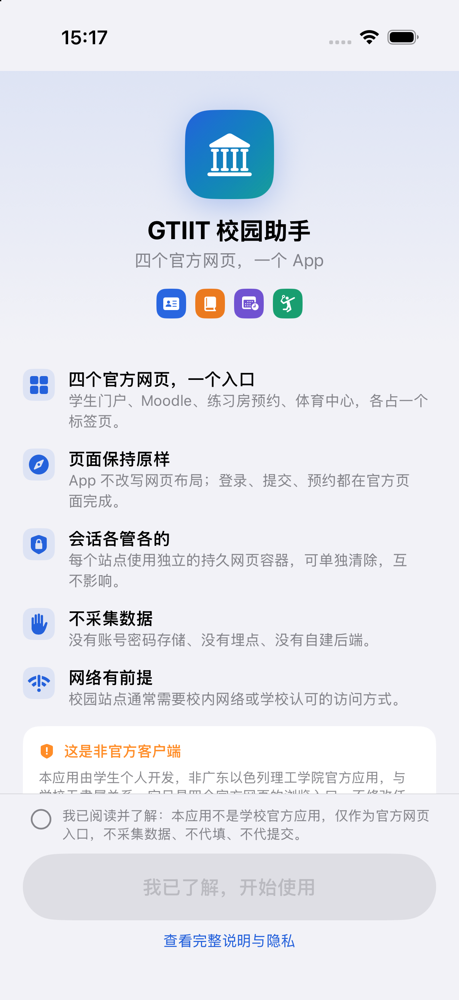
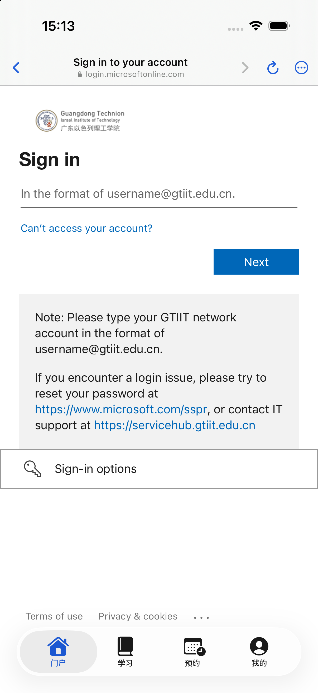
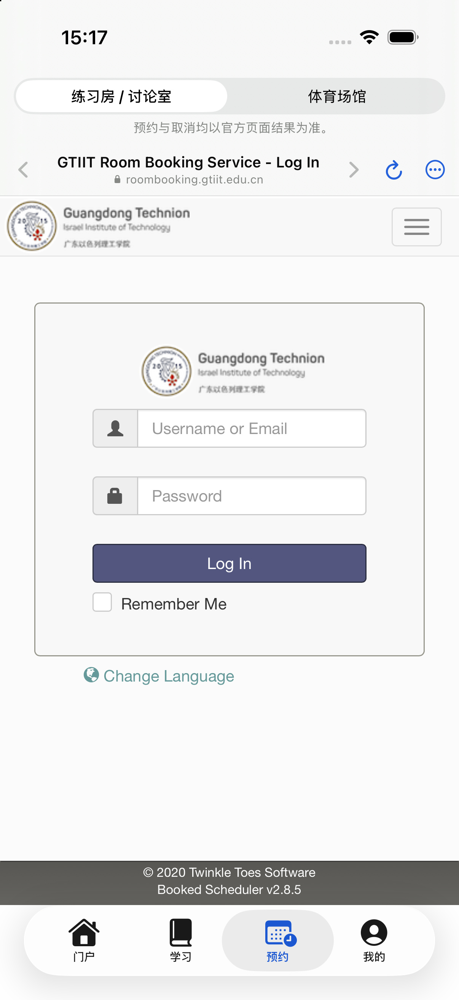
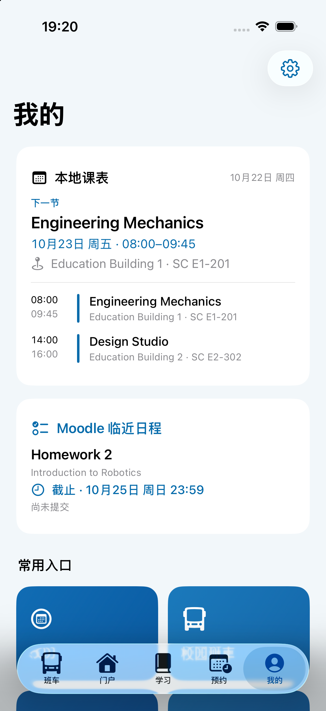
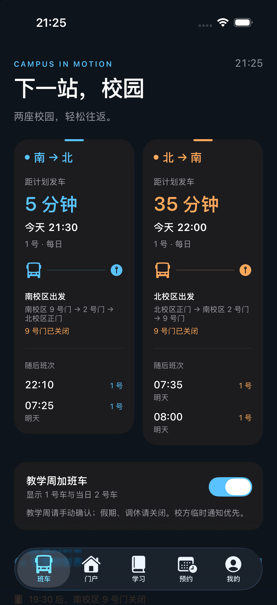
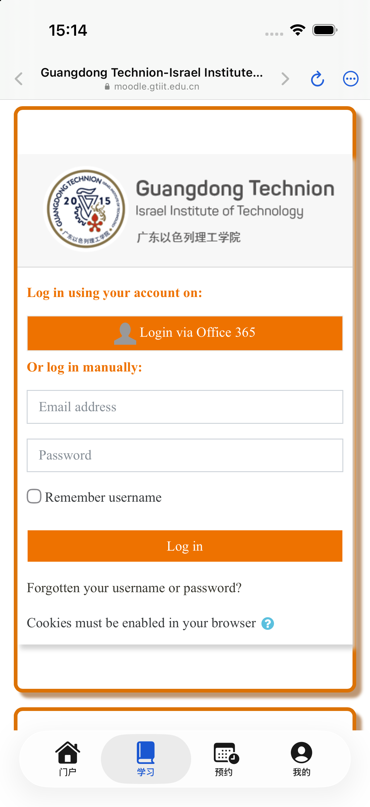
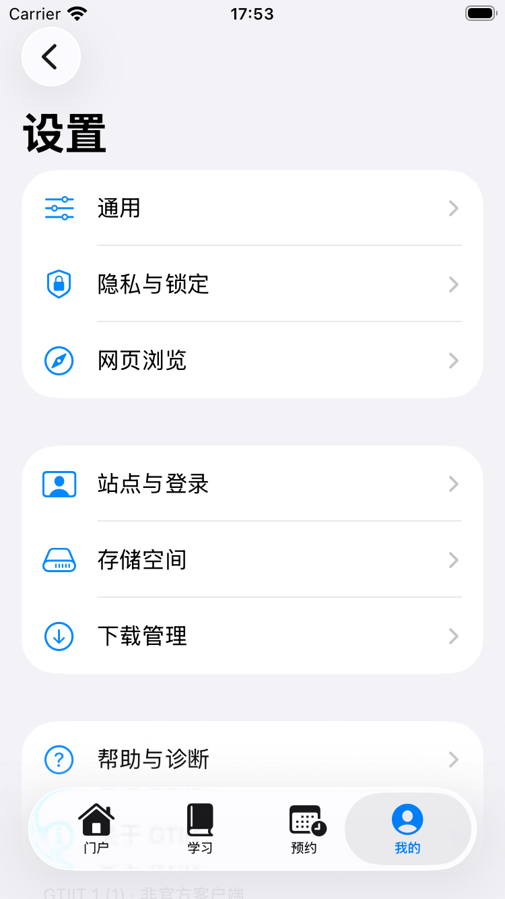
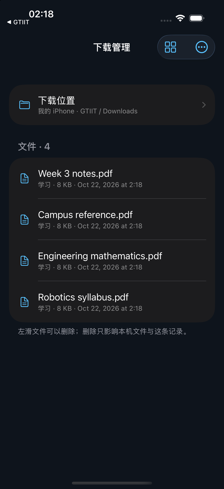
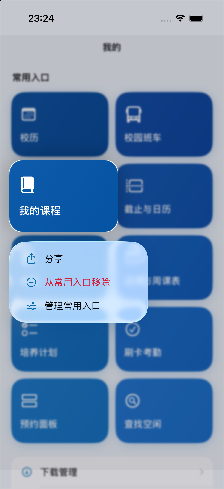
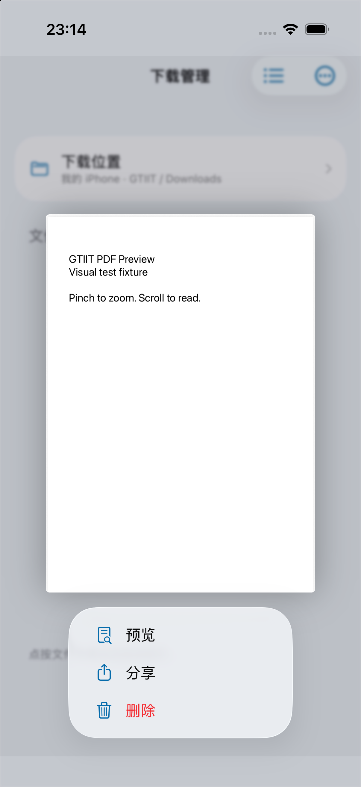

# GTIIT 校园助手 · GTIIT Campus Assistant

[](https://github.com/Optmst0118/gtiit-campus-ios/actions/workflows/ci.yml)
[](LICENSE)
[](https://developer.apple.com/ios/)
[](https://swift.org)
[](CONTRIBUTING.md)

> **非官方项目。** 由学生独立开发，与广东以色列理工学院（GTIIT）及其信息系统运营方没有隶属、授权或背书关系。
> Unofficial, student-built client. Not affiliated with, endorsed by, or supported by GTIIT.

把学校的四个官方网页集中到一个 iOS App，配合原生班车倒计时、离线课表、临近作业、临近考试、PDF 预览与下载管理。课表需用户确认后保存；日程摘要缓存在本机，校园业务在官方网页完成。

**当前版本：2.0.1-beta（build 66）**。版本统一定义于 [Tools/version.json](Tools/version.json)；变更见 [CHANGELOG](CHANGELOG.md)；本次验证范围见 [2.0.1 beta 发布记录](docs/RELEASE-2.0.1-beta.md)。

<p align="center">
  
  
  
  
</p>

---

## 目录

- [它是什么](#它是什么)
- [功能](#功能)
- [截图](#截图)
- [环境要求](#环境要求)
- [快速开始](#快速开始)
- [真机安装](#真机安装)
- [测试与验证](#测试与验证)
- [架构](#架构)
- [项目结构](#项目结构)
- [隐私与安全](#隐私与安全)
- [已知限制](#已知限制)
- [文档](#文档)
- [参与贡献](#参与贡献)
- [许可与声明](#许可与声明)
- [English](#english)

## 它是什么

GTIIT 的日常学习与预约分散在四个系统里：

| 系统 | 作用 | 首页 |
| --- | --- | --- |
| 学生门户 | 学期课程、成绩、考试、选课/周课表、刷卡考勤、申请、培养计划、教学评价 | `students.gtiit.edu.cn` |
| Moodle | 课程、Assignment / Quiz、资料、课程考勤、日历 | `moodle.gtiit.edu.cn` |
| 房间预约 | 练习房 / 讨论室 / 体育场馆等 Booked 资源 | `roombooking.gtiit.edu.cn` |
| 体育中心 | 场馆入口、开放时间、会员预约 | `gtiit.mike-x.com` |

这些系统的网页本身可用，但手机浏览器里来回切换、反复登录、找不到上一页非常低效。本项目因此选择 **网页套壳（web shell）** 路线：

- 每个系统一个独立的持久化 `WKWebsiteDataStore`，会话互不干扰、重启保留、可单站清除；
- 保留官方登录、表单与业务逻辑；网页外观、品牌条与页脚适配独立注入，操作仍由用户在官方页面完成；
- 原生补充**班车、校历、本地课表、临近日程、下载与 PDF 预览、App 锁、设置和错误恢复**。

课表仅提取正式选课的课程名称、班组、星期、时间和教室；Moodle 日程在现有同源网页会话内只读检查当前学期活跃课程的作业名称、开放／截止日期与提交状态；考试读取仅限 Student 当前学期考试组件的课程、类别、日期、时长和地点。原生层不保存密码、会话密钥、成绩、作业正文或附件；邮箱预填为用户可选设置。

## 通用性说明

这个仓库是通用客户端，不包含任何使用者的邮箱、密码、Cookie、学号、课表、Moodle 课程缓存、设备 UDID、签名证书或 Apple 开发团队 ID。Tools/signing.env 是本机忽略文件。

首次安装后，每位 GTIIT 使用者需要自己完成：

1. 用**自己的 Apple 开发团队**签名并安装（仓库不提供可直接侧载的 IPA）；
2. 登录自己的学生门户 / Moodle 账号；
3. 从门户导入自己的课表；
4. 可选填写自己的学校邮箱、开启定位和系统通知。

因此：

- **Moodle 当前课程**只显示与自己的本地课表匹配的课程；
- 未匹配的当前学期内容进入「其他课程」；
- **历史课程**来自自己的 Moodle 课程列表，不在仓库中预置；
- 作业、测验、成绩、预约和网页内容都在登录后从学校官方站点读取；
- 校历、班车时刻表等公共数据随版本提供，学期或时刻表变更后需要更新 App。

默认不启用 App Groups。主屏 Widget 可单独选择方向与教学周／仅每日班车；有共享能力时语言跟随 App，没有共享能力时跟随系统。具有 App Groups 能力的开发团队可以按 README 的 GTIIT_APP_GROUPS=1 方式重新生成并签名。

## 本轮更新 · alpha.39

- 月历月份菜单仅显示年月，使用单选勾；月份支持原生横向翻页和箭头动画。
- 整周课表日期居中吸附，选中日和今天整块加深；普通滑动切一天、快速甩动切一周，并有切换触感。
- PDF保存成功后展开横向液态玻璃圆角条，提供完成状态、分享与系统文件位置浏览。

交付与验证见 [alpha.39 记录](docs/RELEASE-2.0.0-alpha.39.md)。

## 本轮更新 · alpha.38

- 重排月历留白、等宽日期网格与月份切换；假期使用半透明红色圆形日期背景，补上周末及学期间假期。
- 班车实时活动的发车日期、时间和倒计时统一右对齐，加入巴士向右行驶的简洁轨迹示意。

交付与验证见 [alpha.38 记录](docs/RELEASE-2.0.0-alpha.38.md)。

## 本轮更新 · alpha.37

- 下载列表左滑删除与列表／网格长按菜单删除均直接执行。
- Moodle 课程、作业、作业提交与测验页面沿用统一导航精简和浅色／深色背景；保留活动信息和提交控件。

交付与验证见 [alpha.37 记录](docs/RELEASE-2.0.0-alpha.37.md)。

## 本轮更新 · alpha.36

- 修复学习和预约卡片的点击手势冲突，触感放回按钮动作。
- 四站仍同时预加载；课程与考试摘要在预热结束后启动。
- 事项、快捷入口和跨站链接统一路由；网页详情按进入点返回，表单修改离开前确认。
- Moodle 普通返回遵守30分钟缓存；课程目录复用6小时，已提交及较远截止的作业详情复用6小时，临近日程仍逐页补查。支持关注课表外课程。
- “我的”采用紧凑课表、独立作业摘要与考试入口；其他课程和 Moodle 工具进入二级页。
- PDF 下载按钮的玻璃圆面按住轻微放大、松手回弹；触感采用更清晰的刚性／柔性反馈并防止同次操作重复震动。
- 主屏 Widget 支持方向与教学周配置，提前生成发车切换节点；点击直达班车页。
- 新增仅本机的技术计数，CI 加入完整 WebKit 集成回归。

交付与验证见 [alpha.36 记录](docs/RELEASE-2.0.0-alpha.36.md)。

## 功能

### 当前原生功能

- **本地课表**：我的页面可从门户导入；设置 → 课表采用标准横向导航，提供提取、查看与删除。自动识别正式选课后进入核对页，右上角蓝色勾确认保存。当日与下一节课程包含时间、教室和楼宇，点入可看整周。离线快照不会自动同步，变更后需重新导入。
- **Moodle 原生工作台**：原生展示当前课程、临近日程、其他课程和历史课程；当前课程展示与本地课表匹配或主动关注的课程，历史课程在二级页按学期分组为卡片。作业、测验、课程内容和提交仍进入对应官方页面。课程列表来自登录后的 Moodle，摘要以受文件保护、排除备份的文件保存在本机，重启可用；自动间隔 30 分钟，支持手动刷新。退出登录或清除 Moodle 网页数据时同步清除。
- **临近考试**：在“我的”中位于 临近作业下方，独立显示最近一场考试的课程、类别、时间、时长和地点；详情页显示当前学期所有未开始的考试。只读 Student Dashboard 考试组件分页前的数据，在本机受保护缓存，每 30 分钟更新，支持手动刷新；清除门户登录数据时同步清除。未知地点显示待定，临时变更需在 Student 核对。
- **校历**：常用入口内提供 2025–2026／2026–2027 学年、原生月历与原始 PDF。月历采用半透明红色日期背景标注周末、国内假期、逾越节及考试结束次日到下一学期开学前的假期；不把其他节日作为假期。末份校历只显示到已发布的7月底，不虚构下一学期开学日期。学校原件不公开再分发，本机授权原件缺失时仅禁用原始 PDF 入口。
- **常用入口**：两栏蓝色渐变卡片（无障碍大字号使用单栏）；设置 → 通用 → 管理常用入口可添加、隐藏与恢复。网站快捷卡片长按可分享链接、移除与管理；移除仅影响入口。菜单出现后卡片持续等比放大约 12%，连续圆角随比例保持，背景轻微模糊和变暗。无长按菜单的可点击卡片采用按住微缩、松开恢复；遵循减弱动态效果。
- **语言**：设置 → 语言即时切换 English／中文，仅影响原生界面，保留网页实例。
- **以龙彩蛋**：连续点击“关于 GTIIT”标题或简介卡片六次，在设置中解锁。三视图贴纸带碰撞与橡胶回弹；可收起，减弱动态效果时静态展示。

### 2.0 Alpha：预约与系统班车入口

- **首次登录引导**：启动说明第二页集中登录 Student、Moodle、练习房预约与体育中心；底部弹出各站原页面，逐站确认打勾，继续使用同一份网页会话。标题轻浮入、入口按顺序渐显，支持减弱动态效果。
- **原生预约目录**：练习房／讨论室与体育中心采用原生入口，具体可用性、登录和预约仍在对应官方页面完成。设置 → 网页浏览可切换回网页预约。
- **实时活动**：锁屏显示完整南北方向、车号、计划发车时间和系统倒计时；灵动岛支持紧凑、展开和最小布局。重启／回到前台时恢复有效活动并清理失效或重复活动，方向、教学周或语言变化时核对当前活动。没有后台运行机会时由系统显示过期状态，下次进入时清理。
- **附近校区推荐**：班车页可授权仅使用 App 时定位；靠近南校区推荐南→北，靠近北校区推荐北→南。以最近校区中心为基准，超过 5 公里、精度超过 300 米、两校区判断不明确或定位超过 120 秒时不推荐。推荐不自动开启活动，原始坐标不保存、不上传、不写入共享容器。
- **本地提醒**：提前 5／10／15 分钟的偏好跨启动保存，Siri 与 App 共用；支持隐藏通知详情、去重、撤销与教学周变化后的失效清理。通知使用明确的北京时间触发日期，待处理请求设有预算。
- **系统语言**：Intent 标题／通知动作使用中英文系统资源；通知内容和活动状态使用创建时的 App 语言，并在前台设置变更时核对现有内容。
- **扩展构建**：Python 生成器直接生成 App、Widget、依赖和嵌入阶段；CI 验证双 target、相同版本、扩展存在及生成幂等性。`Tools/add_widget_target.rb` 仅转到同一生成器，不再另改工程。

### 网页容器

- **原生标题栏**：四个网站的标题固定为 Student、Moodle dashboard、GTIT room booking service、GTIT sports center，采用原生导航栏；网页内的课程标题不再替换 App 标题，首页与刷新等操作收进更多菜单。
- **五段底部标签**：班车 / 门户 / 学习 / 预约 / 我的；预约内再分「练习房 / 讨论室」与「体育场馆」。
- **每站独立会话**：基于 iOS 17 的 `WKWebsiteDataStore(forIdentifier:)`，可分别清除登录数据。
- **跨站路由**：用户点击的普通 GET 链接会切到对应标签；POST、登录与重定向留在原 WebView，保持表单与 SSO 上下文。
- **真实新窗口**：`window.open` / `target=_blank` 用 WebKit 提供的配置创建子窗口，保留 `opener` 与 `postMessage`。
- **下载**：保留当前响应（含 Cookie / POST / 一次性链接）转成 `WKDownload`，支持进度、取消、服务器支持时续传、同名编号。
- **PDF 预览**：Moodle 的 PDF 先用 PDFKit 预览，右下角按钮显式保存，不会偷偷落盘。
- **网页深色外观**：在隔离脚本世界中为四个校园域增补配色（Dark Reader，MIT），不改页面 JS 原型与业务事件。
- **底栏与恢复**：内容延伸到原生液态玻璃底栏下方；Student 保持完整网页视口，为其内部滚动区末尾和 Checklist 固定操作条单独避让，其他页面使用 WebKit obscured insets。门户复用视图在导入返回时重新挂载。只读且未编辑的普通 GET 页面可限频恢复，表单与 POST 不自动重放。
- **加载与错误**：下拉刷新、进度条、占位与重试；四站错误页均提示校园 Wi-Fi／aTrust，是否可直接跳转由已安装客户端能力决定。冷启动可预加载四站（10 秒上限，可关闭）。

### 原生能力

- **班车**：南→北／北→南双栏，蓝／橙色从上向下渐隐的卡片展示下一班、倒计时和随后班次；点击卡片进入对应方向的完整时刻表（58 个车次，2026-10-12 表；教学周手动确认）。
- **App 锁**：立即 / 1 分钟 / 5 分钟后锁定，Face ID / Touch ID / 设备密码；后台以独立遮罩覆盖网页、分享面板与内置 Safari。
- **下载管理**：紧凑列表／网格、名称／大小／时间双向排序，偏好跨启动保存。默认下载位置可改为本机、iCloud Drive 或受支持文件服务，只影响新下载；旧文件不迁移。列表左滑删除使用系统红色，点击删除即执行，不再二次确认；长按可预览、分享及管理文件。网格使用独立 UIKit collection cell，原生长按仅提升当前文件的缩略图，不会把相邻文件或整个背景一起提起；原生 Quick Look、菜单和关闭后的复原按文件 ID 管理。
- **设置**：课表、语言、通用、隐私与锁定、网页浏览、站点与登录、存储空间、下载管理、帮助与诊断、关于。
- **外观**：跟随系统 / 浅色 / 深色即时生效；`UIContentSizeCategory` 与最大辅助字号适配。
- **网络诊断**：不带 Cookie 的 HEAD 检测，只输出站点、状态码与时间，可分享。
- **无第三方依赖**：没有网络库、没有统计 SDK、没有自建后端；只有系统框架与一个 MIT 许可的 Dark Reader 脚本。

## 截图

| 班车 | 门户 | 预约 |
| --- | --- | --- |
|  |  |  |

| 学习（Moodle） | 我的 | 设置 |
| --- | --- | --- |
|  |  |  |

| 下载管理 |
| --- |
|  |

更多设计稿与验收截图见 [docs/design](docs/design) 与 [docs/verification](docs/verification)。

### 当前长按交互（合成测试数据）

| 持续等比放大的常用入口 | 下载网格中的文档预览 |
| --- | --- |
|  |  |

## 环境要求

| 项 | 要求 |
| --- | --- |
| macOS | 15 或更新 |
| Xcode | **26 或更新**（使用 iOS 26 SDK 的 Liquid Glass API；部署目标为 iOS 17） |
| iOS 设备/模拟器 | iOS 17.0+ |
| 可选 | Python 3（工程生成、检查、回归脚本） |

工程不依赖 CocoaPods / Swift Package Manager / 任何外部库，克隆后即可打开构建。

## 快速开始

```bash
git clone https://github.com/Optmst0118/gtiit-campus-ios.git
cd gtiit-campus-ios
open GTIIT.xcodeproj
```

不需要新建 Xcode 工程：仓库里已经包含完整、可打开的 `GTIIT.xcodeproj`。在已存在的本地目录里更新时，直接 `git pull` 即可。

在 Xcode 中：

1. 选择 target **GTIIT** → **Signing & Capabilities**，选择你自己的开发团队；
2. 选一台 iOS 17+ 模拟器或真机，⌘R 运行。

命令行构建（模拟器，不需要签名）：

```bash
xcodebuild -project GTIIT.xcodeproj -scheme GTIIT -configuration Debug \
  -sdk iphonesimulator -destination 'generic/platform=iOS Simulator' \
  CODE_SIGNING_ALLOWED=NO build
```

### 工程文件是生成的

版本号只修改 `Tools/version.json`，App 与扩展均由生成器读取。生成器使用 Python 标准库，不依赖 Ruby xcodeproj。


`GTIIT.xcodeproj/project.pbxproj` 由脚本生成，新增/删除源文件后运行：

```bash
GTIIT_UNSIGNED=1 python3 Tools/gen_project.py  # 生成可公开提交的无团队工程
python3 Tools/gen_project.py      # 重新生成 pbxproj 与共享 scheme
python3 Tools/check_project.py    # 校验引用、UUID、签名设置、图标与隐私清单
```

签名团队来自环境变量 `DEVELOPMENT_TEAM` 或本机 `Tools/signing.env`（已被 git 忽略）。模板见 `Tools/signing.env.example`。

## 真机安装

```bash
./Tools/install_device.sh          # 自动选择已连接的实体设备
./Tools/install_device.sh <UDID>   # 指定设备
```

脚本会：读取 `Tools/signing.env` 里的团队（或 `DEVELOPMENT_TEAM` 环境变量）→ 构建并自动续签 → 安装 → 启动。**生成器会按本机配置写入签名团队；不需要在 Xcode 手工点 Team，证书与签名密钥不进入仓库。**

首次安装后需要在 iPhone 上信任开发者证书：

> 设置 → 通用 → VPN 与设备管理 → 「Apple Development: …」→ 信任

免费个人团队的描述文件 **7 天过期**，到期重跑脚本即可续签。

> 公开仓库使用中性 bundle id `io.github.optmst0118.gtiit`。如果你之前装过内部版本（`com.zhufengyi.gtiit`），新版本会作为另一个 App 并行安装；想原地升级就改 `Tools/gen_project.py` 里的 `BUNDLE_ID` 后重新生成工程。

## 测试与验证

项目使用独立测试 App 运行真实 WebKit 集成回归，测试数据全部为本地合成数据，不接触真实学生资料。

```bash
# 需要一个名称包含 Review 或 Test 的可丢弃模拟器
python3 Tools/run_regression.py <模拟器 UDID>

# 三种构建（Debug 模拟器 / Release 模拟器 / Release 真机目标）
python3 Tools/verify_builds.py
```

验证证据在 [docs/verification](docs/verification)，各版本的实际验证范围与限制记录在对应的 RELEASE 文档中；历史构建结果不等同于所有版本都重新执行三种构建：

| 验证 | 数量 | 说明 |
| --- | --- | --- |
| 集成回归 | 323 项 | 导航策略、WebKit、下载、锁定、暗色、校历、课表、当前学期过滤、日程缓存与入口配置；最终版本结果见交付记录 |
| 班车检查 | 40 项 | 时刻表解析、跨日、教学周、末班 |
| 构建 | 3 种 | Debug 模拟器、Release 模拟器、Release 真机目标（`CODE_SIGNING_ALLOWED=NO`） |

CI（GitHub Actions）在 `macos-26` 上执行双 target 工程检查、生成幂等性、班车定位／提醒规则、Swift 检查、含 Widget 的模拟器构建及包结构验证。

## 架构

```
界面层  RootTabView / ShuttleView / SiteBrowserView / BookingTabView / MyTabView / SettingsView
          │ 原生只负责导航外壳、状态、设置、下载与锁
应用层  AppModel / AppSettings / AppLockController / LaunchPreparation / PrivacyShieldController
          │
网页内核 BrowserModel（每站一个） · WKWebView + navigation/ui delegate + KVO + 下载
          │
基础设施 WebDataStoreRegistry（每站独立持久化容器） · DownloadCoordinator / PDFPreviewCoordinator
         NavigationPolicy · PopupBrowserController · WebAppearance · NetworkDiagnostics
          │
站点定义 SiteID / AppTab / QuickLink / ShuttleSchedule（纯数据）
```

完整分层、时序与关键决策见 [docs/ARCHITECTURE.md](docs/ARCHITECTURE.md)。

## 项目结构

```
GTIIT-iOS-App/
├── GTIIT.xcodeproj/            # 由 Tools/gen_project.py 生成
├── GTIIT/
│   ├── App/                    # 入口、AppModel、设置、锁、隐私遮罩
│   ├── Components/             # 浏览器部件、下载浮窗、设置选择器
│   ├── Core/                   # 主题、App 信息
│   ├── Models/                 # 站点、Tab、快捷入口、班车时刻
│   ├── Services/               # 网页内核、数据容器、下载、导航策略、外观
│   ├── Views/                  # 五个一级页面与设置、帮助、锁屏
│   └── Resources/              # Assets、隐私清单、Dark Reader 脚本与许可
├── Tests/                      # 回归脚手架、UI Review、合成数据服务
├── Tools/                      # 工程生成/检查、构建验证、回归、图标、真机安装
├── docs/                       # 架构、研究、评审、设计、验收与截图
├── CONTRIBUTING.md · CODE_OF_CONDUCT.md · SECURITY.md · CHANGELOG.md
└── LICENSE
```

## 隐私与安全

- **定位**：仅在用户授权且班车页位于前台时获取位置；只在内存判断最近校区，不记录轨迹或发送给学校及其他服务。离开班车页或进入后台停止定位。

- **不采集数据**：没有自建后端、统计 SDK、埋点或崩溃上报；仓库内没有真实学生数据。
- **账号只在官方网页输入**：App 代码不接触账号密码，不注入登录表单；课程提取是用户主动发起、字段受限的本地读取。
- **会话只在本地**：Cookie 与网页存储在 WebKit 沙盒内，四站隔离；可单站或全站清除。
- **本地数据**：课表与日程摘要使用受文件保护、排除备份的 Application Support；日程随 Moodle 登录数据清除，考试摘要随门户登录数据清除。下载默认保存在 Documents/Downloads，也可使用用户授权的外部目录；更换目录不迁移旧文件，外部文件不参与限时清理。
- **锁屏**：`LocalAuthentication` 的设备密码 / 生物识别，App 只收到成功或失败。
- **隐私清单**：`PrivacyInfo.xcprivacy` 声明不追踪、不收集数据，仅使用 UserDefaults 保存本机偏好。
- **网络**：网页和日程读取沿用官方同源会话；诊断向公开首页发不带 Cookie、无缓存、无重定向的 HEAD。暗色适配只按需读取当前页面 CSS；没有自建后端或统计服务。

发现安全问题请按 [SECURITY.md](SECURITY.md) 私下报告，不要公开提交 Issue。

## 已知限制

- 当前签名账号未启用 App Groups。实时活动通过 Activity attributes 传递状态正常工作；共享容器不记为已启用。具有相应能力的开发团队可用 `GTIIT_APP_GROUPS=1 python3 Tools/gen_project.py` 同时生成双端 entitlement 设置，然后重新签名并运行包验证。
- `python3 Tools/verify_bundle.py <GTIIT.app>` 验证真机包与扩展的版本、签名及 profile 一致；CI 的 `--unsigned` 只验证结构和版本，不等同于真机签名验证。

1. 四个站点需要在 App 内**分别登录**；Safari 的会话不会自动迁入。
2. 校园站点通常需要**校园网或学校认可的访问方式**，校外网络可能无法解析。
3. 学校页面、SSO、课表结构与 Moodle 只读 API 可能调整，届时需要更新深链或识别器。部分课程信息缺失时会提示结果不完整，仍应在官方页面核对。
4. 班车倒计时是**计划发车时间**，没有实时 GPS；时刻表来自用户提供的 2026-10-12 表，教学周需手动确认。
5. 免费个人团队签名的描述文件 **7 天过期**。
6. 网页暗色适配不保证覆盖所有学校组件，可按站点恢复原色；真实校园页受校园网／VPN 条件影响，合成测试不替代完整真机验收。
7. App 不代填、不代提交任何业务；成绩、考勤等敏感页面只在你本机浏览。
8. 分层 Liquid Glass 图标工程（`docs/design/AppIcon.icon`）需要 Xcode 27；默认使用 PNG 图标，以便在 Xcode 26 上构建。

## 文档

| 文档 | 内容 |
| --- | --- |
| [docs/ARCHITECTURE.md](docs/ARCHITECTURE.md) | 分层、会话隔离、跨站路由、时序 |
| [docs/RESEARCH-SPEC.md](docs/RESEARCH-SPEC.md) | 站点能力边界、信息架构与中文文案规格 |
| [docs/design/DESIGN.md](docs/design/DESIGN.md) | 配色、图标、动效与设计来源 |
| [docs/RELEASE-1.4.md](docs/RELEASE-1.4.md) | 1.4 变更与验收 |
| [docs/IMPROVEMENTS-20261021.md](docs/IMPROVEMENTS-20261021.md) | 1.1 审查问题与修复对照 |
| [docs/QA-REPORT.md](docs/QA-REPORT.md) | 独立 QA（P0=0 / P1=2，已修复） |
| [CHANGELOG.md](CHANGELOG.md) | 版本记录 |

## 参与贡献

欢迎 Issue 与 PR，请先阅读 [CONTRIBUTING.md](CONTRIBUTING.md) 与 [CODE_OF_CONDUCT.md](CODE_OF_CONDUCT.md)。

几条硬性边界：

- 只读取课表、Moodle 待办和 Student 考试已明确授权的字段；不扩展到成绩、账号、通用页面采集、写业务接口、绕过验证码/证书、硬编码凭据或伪造数据；
- 不提交真实学生数据、截图中的账号信息或设备标识；
- 涉及网页注入的改动必须说明作用域，并补充回归测试；
- 提交前运行 `python3 Tools/gen_project.py`、`python3 Tools/check_project.py` 与模拟器构建。

## 许可与声明

- 代码以 [MIT License](LICENSE) 发布，Copyright © 2026 Tony Zhu (Optmst0118)。
- 第三方组件与许可见 [THIRD-PARTY-NOTICES.md](THIRD-PARTY-NOTICES.md)：Dark Reader（MIT）。
- 「GTIIT」「广东以色列理工学院」、校徽与相关标识属于学校；本项目只在描述用途时使用，不主张任何权利。图标与界面为**非官方改绘**，不代表学校。若你是校方并希望调整使用方式，请通过 Issue 联系。

> 本项目不提供任何形式的担保。学校系统变化、账号安全与预约结果请以官方为准；请勿把本项目的 Issue 当作学校 IT 支持渠道。

## English

An unofficial, open-source iOS client for GTIIT campus services, written in SwiftUI. It wraps the four official websites in isolated, persistent `WKWebView` sessions and adds native features the web cannot provide: a campus shuttle schedule with countdowns, download management with PDF preview, an app lock, appearance settings and network diagnostics.

**Highlights**

- Five tabs: Shuttle · Portal · Learning · Booking · Me; booking switches between practice rooms and sports venues.
- Per-site persistent `WKWebsiteDataStore` (iOS 17+), cross-site routing only for user-initiated GET links, real popup windows, and downloads that keep the original POST/cookie context.
- No analytics, backend or account storage. Optional, explicitly confirmed timetable imports read registered course fields only and stay on the device. All sessions live in the WebKit sandbox and can be cleared per site.
- Protected local timetable and Moodle summaries; current-term active courses only, 30-minute automatic refresh, manual refresh, and cache removal with Moodle website data.
- Persistent shortcut management in Settings → General. Native context menus keep a proportional 12% card enlargement, matching continuous corners, subtle background blur/dimming, and document-only grid lift targets. Settings → Timetable uses standard push navigation.
- Live Activity shuttle countdowns with explicit direction, local reminders with persisted lead time, and optional foreground campus proximity suggestions; no location history is stored or uploaded.
- App and Widget targets are generated together from one version file, with embedded-extension and signing/profile verification. App Groups remain disabled for the current signing team.
- No third-party package dependencies; Dark Reader (MIT) is bundled only for optional web dark appearance.

**Build**

```bash
open GTIIT.xcodeproj   # Xcode 26+, iOS 17+ deployment target
xcodebuild -project GTIIT.xcodeproj -scheme GTIIT -sdk iphonesimulator \
  -destination 'generic/platform=iOS Simulator' CODE_SIGNING_ALLOWED=NO build
```

**Disclaimer** — Not affiliated with GTIIT. Names and emblems belong to the university. Use at your own risk; campus systems may change without notice.

## 致谢

- README 的组织方式参考了 [muster](https://github.com/ZacxDev/muster)（简洁定义 → 功能 → 快速开始 → 文档）与 [TUM Campus-iOS](https://github.com/TUM-Dev/Campus-iOS)（截图表格、贡献入口、许可声明）等开源项目。
- 网页深色外观使用 [Dark Reader](https://github.com/darkreader/darkreader)（MIT）。
- 感谢所有公开分享 iOS 网页容器、WebKit 与 SwiftUI 实践的开源作者。