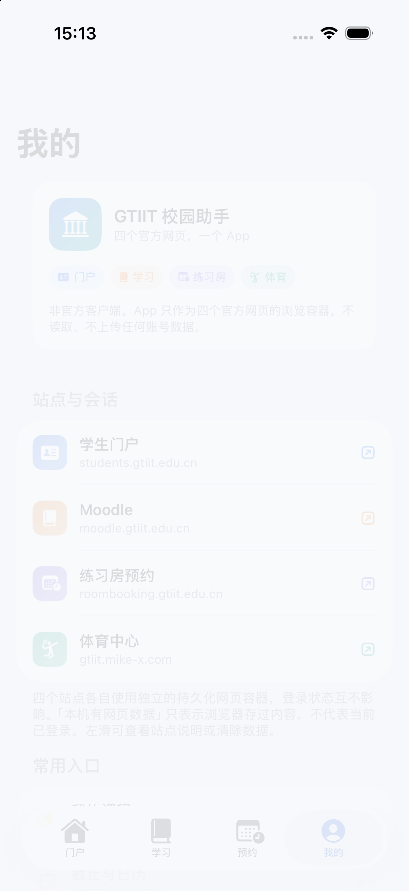

# GTIIT 校园助手 · GTIIT Campus Assistant

[](https://github.com/Optmst0118/gtiit-campus-ios/actions/workflows/ci.yml)
[](LICENSE)
[](https://developer.apple.com/ios/)
[](https://swift.org)
[](CONTRIBUTING.md)

> **非官方项目。** 由学生独立开发，与广东以色列理工学院（GTIIT）及其信息系统运营方没有隶属、授权或背书关系。
> Unofficial, student-built client. Not affiliated with, endorsed by, or supported by GTIIT.

把学校的四个官方网页装进一个 iOS App，再把网页做不到的事用原生补齐：班车倒计时、下载管理、App 锁、外观与设置。App 不抓取、不转发、不代提交任何校园业务数据。

<p align="center">
  
  
  
  
</p>

---

## 目录

- [它是什么](#它是什么)
- [功能](#功能)
- [截图](#截图)
- [环境要求](#环境要求)
- [快速开始](#快速开始)
- [真机安装](#真机安装)
- [测试与验证](#测试与验证)
- [架构](#架构)
- [项目结构](#项目结构)
- [隐私与安全](#隐私与安全)
- [已知限制](#已知限制)
- [文档](#文档)
- [参与贡献](#参与贡献)
- [许可与声明](#许可与声明)
- [English](#english)

## 它是什么

GTIIT 的日常学习与预约分散在四个系统里：

| 系统 | 作用 | 首页 |
| --- | --- | --- |
| 学生门户 | 学期课程、成绩、考试、选课/周课表、刷卡考勤、申请、培养计划、教学评价 | `students.gtiit.edu.cn` |
| Moodle | 课程、Assignment / Quiz、资料、课程考勤、日历 | `moodle.gtiit.edu.cn` |
| 房间预约 | 练习房 / 讨论室 / 体育场馆等 Booked 资源 | `roombooking.gtiit.edu.cn` |
| 体育中心 | 场馆入口、开放时间、会员预约 | `gtiit.mike-x.com` |

这些系统的网页本身可用，但手机浏览器里来回切换、反复登录、找不到上一页非常低效。本项目因此选择 **网页套壳（web shell）** 路线：

- 每个系统一个独立的持久化 `WKWebsiteDataStore`，会话互不干扰、重启保留、可单站清除；
- 网页布局与业务逻辑完全不改，登录、提交、预约都在官方页面完成；
- 原生只负责网页无法稳定提供的能力：**班车时刻**、**下载与 PDF 预览**、**App 锁**、**设置**、**加载/错误状态**。

这不是把网页截图或数据抓下来做成原生列表。App 代码不读取页面内容、不解析接口、不保存账号密码。

## 功能

### 网页容器

- **五段底部标签**：班车 / 门户 / 学习 / 预约 / 我的；预约内再分「练习房 / 讨论室」与「体育场馆」。
- **每站独立会话**：基于 iOS 17 的 `WKWebsiteDataStore(forIdentifier:)`，可分别清除登录数据。
- **跨站路由**：用户点击的普通 GET 链接会切到对应标签；POST、登录与重定向留在原 WebView，保持表单与 SSO 上下文。
- **真实新窗口**：`window.open` / `target=_blank` 用 WebKit 提供的配置创建子窗口，保留 `opener` 与 `postMessage`。
- **下载**：保留当前响应（含 Cookie / POST / 一次性链接）转成 `WKDownload`，支持进度、取消、服务器支持时续传、同名编号。
- **PDF 预览**：Moodle 的 PDF 先用 PDFKit 预览，右下角按钮显式保存，不会偷偷落盘。
- **网页深色外观**（1.5）：在隔离脚本世界中为四个校园域增补配色（Dark Reader，MIT），不改页面 JS 原型与业务事件。
- **加载与错误**：下拉刷新、进度条、白屏占位、可操作的错误页；冷启动可并行预加载四站（10 秒上限，可关闭）。

### 原生能力

- **班车**：南→北 / 北→南双栏，下一班、倒计时、随后班次与完整时刻表（58 个车次，来源为用户提供的 2026-10-12 表；教学周手动确认）。
- **App 锁**：立即 / 1 分钟 / 5 分钟后锁定，Face ID / Touch ID / 设备密码；后台以独立遮罩覆盖网页、分享面板与内置 Safari。
- **下载管理**：保留期限（永久 / 下次启动 / 1 天 / 7 天）、列表与缩略图两种视图、排序、分享、删除；默认保存到「文件 → 我的 iPhone → GTIIT → Downloads」。
- **设置**：通用、隐私与锁定、网页浏览、站点与登录、存储空间、下载管理、帮助与诊断、关于。
- **外观**：跟随系统 / 浅色 / 深色即时生效；`UIContentSizeCategory` 与最大辅助字号适配。
- **网络诊断**：不带 Cookie 的 HEAD 检测，只输出站点、状态码与时间，可分享。
- **无第三方依赖**：没有网络库、没有统计 SDK、没有自建后端；只有系统框架与一个 MIT 许可的 Dark Reader 脚本。

## 截图

| 班车 | 门户 | 预约 |
| --- | --- | --- |
|  |  |  |

| 学习（Moodle） | 我的 | 设置 |
| --- | --- | --- |
|  |  |  |

| 下载管理 |
| --- |
|  |

更多设计稿与验收截图见 [docs/design](docs/design) 与 [docs/verification](docs/verification)。

## 环境要求

| 项 | 要求 |
| --- | --- |
| macOS | 15 或更新 |
| Xcode | **26 或更新**（使用 iOS 26 SDK 的 Liquid Glass API；部署目标为 iOS 17） |
| iOS 设备/模拟器 | iOS 17.0+ |
| 可选 | Python 3（工程生成、检查、回归脚本） |

工程不依赖 CocoaPods / Swift Package Manager / 任何外部库，克隆后即可打开构建。

## 快速开始

```bash
git clone https://github.com/Optmst0118/gtiit-campus-ios.git
cd gtiit-campus-ios
open GTIIT.xcodeproj
```

不需要新建 Xcode 工程：仓库里已经包含完整、可打开的 `GTIIT.xcodeproj`。在已存在的本地目录里更新时，直接 `git pull` 即可。

在 Xcode 中：

1. 选择 target **GTIIT** → **Signing & Capabilities**，选择你自己的开发团队；
2. 选一台 iOS 17+ 模拟器或真机，⌘R 运行。

命令行构建（模拟器，不需要签名）：

```bash
xcodebuild -project GTIIT.xcodeproj -scheme GTIIT -configuration Debug \
  -sdk iphonesimulator -destination 'generic/platform=iOS Simulator' \
  CODE_SIGNING_ALLOWED=NO build
```

### 工程文件是生成的

`GTIIT.xcodeproj/project.pbxproj` 由脚本生成，新增/删除源文件后运行：

```bash
python3 Tools/gen_project.py      # 重新生成 pbxproj 与共享 scheme
python3 Tools/check_project.py    # 校验引用、UUID、签名设置、图标与隐私清单
```

签名团队来自环境变量 `DEVELOPMENT_TEAM` 或本机 `Tools/signing.env`（已被 git 忽略）。模板见 `Tools/signing.env.example`。

## 真机安装

```bash
./Tools/install_device.sh          # 自动选择已连接的实体设备
./Tools/install_device.sh <UDID>   # 指定设备
```

脚本会：读取 `Tools/signing.env` 里的团队（或 `DEVELOPMENT_TEAM` 环境变量）→ 构建并自动续签 → 安装 → 启动。**不需要在 Xcode 里手工点 Team，也不会把团队写进 `project.pbxproj`。**

首次安装后需要在 iPhone 上信任开发者证书：

> 设置 → 通用 → VPN 与设备管理 → 「Apple Development: …」→ 信任

免费个人团队的描述文件 **7 天过期**，到期重跑脚本即可续签。

> 公开仓库使用中性 bundle id `io.github.optmst0118.gtiit`。如果你之前装过内部版本（`com.zhufengyi.gtiit`），新版本会作为另一个 App 并行安装；想原地升级就改 `Tools/gen_project.py` 里的 `BUNDLE_ID` 后重新生成工程。

## 测试与验证

项目使用独立测试 App 运行真实 WebKit 集成回归，测试数据全部为本地合成数据，不接触真实学生资料。

```bash
# 需要一个名称包含 Review 或 Test 的可丢弃模拟器
python3 Tools/run_regression.py <模拟器 UDID>

# 三种构建（Debug 模拟器 / Release 模拟器 / Release 真机目标）
python3 Tools/verify_builds.py
```

最新机器结果在 [docs/verification](docs/verification)：

| 验证 | 数量 | 说明 |
| --- | --- | --- |
| 集成回归 | 122 项 | 导航策略、真实 WebKit POST / blob / 弹窗、下载、清理、保留期限、诊断、锁定状态 |
| 班车检查 | 40 项 | 时刻表解析、跨日、教学周、末班 |
| 构建 | 3 种 | Debug 模拟器、Release 模拟器、Release 真机目标（`CODE_SIGNING_ALLOWED=NO`） |

CI（GitHub Actions）在 `macos-26` 上执行工程检查与模拟器构建。

## 架构

```
界面层  RootTabView / ShuttleView / SiteBrowserView / BookingTabView / MyTabView / SettingsView
          │ 原生只负责导航外壳、状态、设置、下载与锁
应用层  AppModel / AppSettings / AppLockController / LaunchPreparation / PrivacyShieldController
          │
网页内核 BrowserModel（每站一个） · WKWebView + navigation/ui delegate + KVO + 下载
          │
基础设施 WebDataStoreRegistry（每站独立持久化容器） · DownloadCoordinator / PDFPreviewCoordinator
         NavigationPolicy · PopupBrowserController · WebAppearance · NetworkDiagnostics
          │
站点定义 SiteID / AppTab / QuickLink / ShuttleSchedule（纯数据）
```

完整分层、时序与关键决策见 [docs/ARCHITECTURE.md](docs/ARCHITECTURE.md)。

## 项目结构

```
GTIIT-iOS-App/
├── GTIIT.xcodeproj/            # 由 Tools/gen_project.py 生成
├── GTIIT/
│   ├── App/                    # 入口、AppModel、设置、锁、隐私遮罩
│   ├── Components/             # 浏览器部件、下载浮窗、设置选择器
│   ├── Core/                   # 主题、App 信息
│   ├── Models/                 # 站点、Tab、快捷入口、班车时刻
│   ├── Services/               # 网页内核、数据容器、下载、导航策略、外观
│   ├── Views/                  # 五个一级页面与设置、帮助、锁屏
│   └── Resources/              # Assets、隐私清单、Dark Reader 脚本与许可
├── Tests/                      # 回归脚手架、UI Review、合成数据服务
├── Tools/                      # 工程生成/检查、构建验证、回归、图标、真机安装
├── docs/                       # 架构、研究、评审、设计、验收与截图
├── CONTRIBUTING.md · CODE_OF_CONDUCT.md · SECURITY.md · CHANGELOG.md
└── LICENSE
```

## 隐私与安全

- **不采集数据**：没有自建后端、统计 SDK、埋点或崩溃上报；仓库内没有真实学生数据。
- **账号只在官方网页输入**：App 代码不接触账号密码，不注入登录表单，不读取页面内容。
- **会话只在本地**：Cookie 与网页存储在 WebKit 沙盒内，四站隔离；可单站或全站清除。
- **下载本地保存**：文件写入 App 的 Documents/Downloads，可随时删除；不上传。
- **锁屏**：`LocalAuthentication` 的设备密码 / 生物识别，App 只收到成功或失败。
- **隐私清单**：`PrivacyInfo.xcprivacy` 声明不追踪、不收集数据，仅使用 UserDefaults 保存本机偏好。
- **网络**：只访问四个校园站点及其登录跳转域名；ATS 只为网页内容放开，App 自身没有网络请求。

发现安全问题请按 [SECURITY.md](SECURITY.md) 私下报告，不要公开提交 Issue。

## 已知限制

1. 四个站点需要在 App 内**分别登录**；Safari 的会话不会自动迁入。
2. 校园站点通常需要**校园网或学校认可的访问方式**，校外网络可能无法解析。
3. 学校页面、SSO 与接口可能随时调整；App 不抓取接口，因此页面改版后可能需要更新深链。
4. 班车倒计时是**计划发车时间**，没有实时 GPS；时刻表来自用户提供的 2026-10-12 表，教学周需手动确认。
5. 免费个人团队签名的描述文件 **7 天过期**。
6. 1.5 的网页深色外观仍是**开发快照**，覆盖不保证所有页面组件。
7. App 不代填、不代提交任何业务；成绩、考勤等敏感页面只在你本机浏览。
8. 分层 Liquid Glass 图标工程（`docs/design/AppIcon.icon`）需要 Xcode 27；默认使用 PNG 图标，以便在 Xcode 26 上构建。

## 文档

| 文档 | 内容 |
| --- | --- |
| [docs/ARCHITECTURE.md](docs/ARCHITECTURE.md) | 分层、会话隔离、跨站路由、时序 |
| [docs/RESEARCH-SPEC.md](docs/RESEARCH-SPEC.md) | 站点能力边界、信息架构与中文文案规格 |
| [docs/design/DESIGN.md](docs/design/DESIGN.md) | 配色、图标、动效与设计来源 |
| [docs/RELEASE-1.4.md](docs/RELEASE-1.4.md) | 1.4 变更与验收 |
| [docs/IMPROVEMENTS-20261021.md](docs/IMPROVEMENTS-20261021.md) | 1.1 审查问题与修复对照 |
| [docs/QA-REPORT.md](docs/QA-REPORT.md) | 独立 QA（P0=0 / P1=2，已修复） |
| [CHANGELOG.md](CHANGELOG.md) | 版本记录 |

## 参与贡献

欢迎 Issue 与 PR，请先阅读 [CONTRIBUTING.md](CONTRIBUTING.md) 与 [CODE_OF_CONDUCT.md](CODE_OF_CONDUCT.md)。

几条硬性边界：

- 不加入抓取页面、解析接口、绕过验证码/证书、硬编码凭据或伪造数据；
- 不提交真实学生数据、截图中的账号信息或设备标识；
- 涉及网页注入的改动必须说明作用域，并补充回归测试；
- 提交前运行 `python3 Tools/gen_project.py`、`python3 Tools/check_project.py` 与模拟器构建。

## 许可与声明

- 代码以 [MIT License](LICENSE) 发布，Copyright © 2026 Tony Zhu (Optmst0118)。
- 第三方组件与许可见 [THIRD-PARTY-NOTICES.md](THIRD-PARTY-NOTICES.md)：Dark Reader（MIT）。
- 「GTIIT」「广东以色列理工学院」、校徽与相关标识属于学校；本项目只在描述用途时使用，不主张任何权利。图标与界面为**非官方改绘**，不代表学校。若你是校方并希望调整使用方式，请通过 Issue 联系。

> 本项目不提供任何形式的担保。学校系统变化、账号安全与预约结果请以官方为准；请勿把本项目的 Issue 当作学校 IT 支持渠道。

## English

An unofficial, open-source iOS client for GTIIT campus services, written in SwiftUI. It wraps the four official websites in isolated, persistent `WKWebView` sessions and adds native features the web cannot provide: a campus shuttle schedule with countdowns, download management with PDF preview, an app lock, appearance settings and network diagnostics.

**Highlights**

- Five tabs: Shuttle · Portal · Learning · Booking · Me; booking switches between practice rooms and sports venues.
- Per-site persistent `WKWebsiteDataStore` (iOS 17+), cross-site routing only for user-initiated GET links, real popup windows, and downloads that keep the original POST/cookie context.
- No scraping, no analytics, no backend, no account storage. All sessions live in the WebKit sandbox and can be cleared per site.
- No third-party dependencies; Dark Reader (MIT) is bundled only for optional web dark appearance.

**Build**

```bash
open GTIIT.xcodeproj   # Xcode 26+, iOS 17+ deployment target
xcodebuild -project GTIIT.xcodeproj -scheme GTIIT -sdk iphonesimulator \
  -destination 'generic/platform=iOS Simulator' CODE_SIGNING_ALLOWED=NO build
```

**Disclaimer** — Not affiliated with GTIIT. Names and emblems belong to the university. Use at your own risk; campus systems may change without notice.

## 致谢

- README 的组织方式参考了 [muster](https://github.com/ZacxDev/muster)（简洁定义 → 功能 → 快速开始 → 文档）与 [TUM Campus-iOS](https://github.com/TUM-Dev/Campus-iOS)（截图表格、贡献入口、许可声明）等开源项目。
- 网页深色外观使用 [Dark Reader](https://github.com/darkreader/darkreader)（MIT）。
- 感谢所有公开分享 iOS 网页容器、WebKit 与 SwiftUI 实践的开源作者。