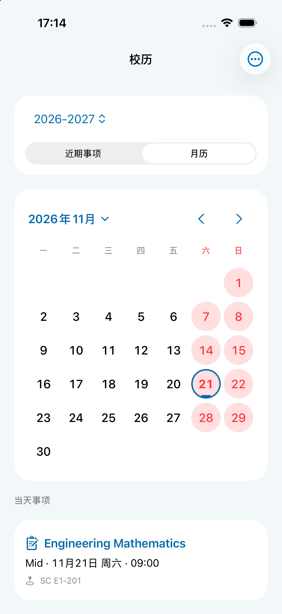

# 2.0.0-alpha.40 · build 57

2026-10-24，基线 `1a6a8ad`（alpha.39）。

## PDF 玻璃控件

保持同一块原生 Liquid Glass 表面和右侧锚点，保存成功后以弹簧过渡展开宽度、圆角和前景内容。下载、保存中、已下载的内容在内部过渡，不通过替换两个背景模拟展开。保留分享和实际保存目录入口；减弱动态效果使用短淡入，减弱透明度使用实色。

[PDF保存形变录屏](design/alpha40/pdf-save-morph.mp4)记录了连续展开的中间状态，避免仅用保存前后静态截图判断动画。

参考 [Apple：Applying Liquid Glass to custom views](https://developer.apple.com/documentation/swiftui/applying-liquid-glass-to-custom-views)。

## 校历考试

校历选项菜单增加“显示考试时间”，跨启动保存。复用 StudentExamStore 中 Student Dashboard 考试组件的分页前完整列表，不使用仅展示下一场的摘要。期中、期末及其他门户已发布场次都保留，不增加独立抓取链路；沿用现有登录和30分钟缓存节流。没有在 Student 发布的考试不会自行推算。

月历考试日增加蓝色短标记，与放假红色背景分别表达；选择日期可查看课程、场次、时间和地点。近期事项显示本学年尚未过期的考试；“显示全部事项”可查看已过日期。学年范围之外与无效日期不进入月历，不改变现有假期计算。

## 课表滑动

普通或快速滑动均最多到相邻一天。周日前往下周一、周一返回上周日时，先产生阻力；手指继续移动超过阈值才接受跨周；不提供触摸采样的间接滚动需在同一边界再次发起滚动，不根据速度推算七天。显式周箭头仍切换七天。吸附使用短的 ease-out 收尾，接受新日期时触发一次选择触感；两侧18点渐隐不改变卡片宽度与居中位置。减弱动态效果不播放收尾动画。

## 验证

331项集成回归全部通过，覆盖期中/期末完整读取、跨学年筛选、考试日期与地点、无效日期排除，以及相邻切日、周边界短拖阻挡和持续拖动跨周。原有PDF单次响应、POST/一次性链接、保存位置与预览生命周期回归继续通过。

独立界面验证检查了PDF保存前后状态、考试开关、近期事项、考试日标记及当天详情、课表居中和两侧渐隐、周日继续滚动进入下周一。验证工具的反向拖动未提供有效位移，因此反向跨周已验证策略计算，未声称完成连续反向手势实测。模拟器不用于量化真实触感；本轮未重新读取真实Student账号的考试记录。

Release设备构建、签名和扩展版本检查通过。已覆盖安装到iPhone Air，系统应用列表确认2.0.0 (57)，保留原有数据。

安装后远程启动因手机锁定被系统拒绝，尚未完成本轮真机前台启动与触感实测。
