# 2.0.1 beta · build 64

2026-10-26；基线 `64b6faf`（2.0.0-alpha.40）。

## 图标与主题

通过 imagegen 清理重绘标志，去掉制图圆、交叉辅助线和细线底稿。Icon Composer 源文件现纳入 App 资源，浅色天蓝、深色海军蓝底色；同一前景分别编译成1024px不透明旧系统后备图标。关于页保留重绘图标并跟随 App 外观背景。桌面图标遵循 iOS 系统的图标外观选择。

二级页面统一白色／深色标题栏，大标题保留系统滚动边缘，避免 iOS 26 强制背景可见时标题消失。深色标题栏与我的页面画布保持一致，补齐此前仍使用系统分组黑底的设置子页面。

## 五课课表与滚动

竖屏根据实际安全区内的可用高度排布，收紧周控制、五个课程行与学期信息；保留起止时间、课程名称、教室/楼宇、课程编号。辅助功能大字号使用可纵向阅读布局，不强行缩小文字。

课表从一次创建、测量全部日期的 HStack 改为可复用 UICollectionView 单元，只更新可见卡片。使用系统速度跟踪与减速目标，不再强制中止惯性后播放第二段 UIView 动画。周日/周一仍有轻微边界阻力，但拖动系数从0.45提高为0.82，跨周阈值从半张卡减至0.38张。普通滑动最多到相邻一天，周箭头显式切换一周。没有使用或声称复制 Calendar 的私有动画参数。

## 常用入口与我的页面

常用入口使用原生 UICollectionView 拖放与上下文菜单，系统负责手指停留和移动时的手势优先级。分享、编辑、移除保留在原生菜单内；提升和回落共用实际卡片的连续圆角路径，透明背景，没有额外放大预览或白色描边。

编辑按钮直接在当前页面显示各卡片右上角的系统红色圆形减号；添加入口仍进入现有管理页。重排及移除分别存储，不影响学校业务与原有页面。辅助功能也可前后移动卡片。

设置 → 通用 → 管理“我的”入口提供本地课表、临近作业、临近考试、常用入口的开关和顺序。下载管理、设置、帮助保留独立底部入口，即使隐藏常用入口仍可访问。旧安装默认显示所有原有模块。

## 本轮修复

- 横屏侧栏内容贴合右侧物理边缘；收起按钮保留在左上安全区内，侧栏画布与浅/深色页面一致。
- Student 将常用站内导航、刷新和更多操作移入原生标题栏，二级网页继续复用同一 WebKit 会话；网页重复通知/故障控件隐藏。
- 临近作业统一显示编号格式 `Homework (n) Assignment`，仅作用于编号作业展示。
- 下载目录保留安全作用域并允许 OneDrive 等云提供商的延迟物化目录。

## 作业与预约

临近日程统一命名为临近作业。移除详情顶部常驻状态卡，将最近更新时间放在“即将截止与最近开放”下方；需要登录或重试时保留对应操作。

练习房、体育场馆原生首页及网页详情提供刷新和更多菜单；菜单可进入官网、分享、查看站点与登录信息。刷新使用既有站点模型，不改动表单或登录方式。四站预加载仍保持原有并行策略。

## 验证

334项完整集成回归通过，包括新增的入口开关、顺序、重启保存及未知/重复偏好迁移检查。工程检查、中英文本覆盖检查、Release设备构建与扩展签名/版本检查通过。

独立模拟器检查了竖屏五节课首屏完整展示、英文深色卡片、原位红色减号、移除补位、辅助功能排序、管理“我的”入口的开关与排序、原生长按模糊与圆角、预约两类首页及网页详情工具栏、大标题恢复和作业卡片下的更新时间。英文长预约标题已缩短，场馆名允许两行并去除重复副标题。标题及换行修正以最终界面编译复核；未把模拟器测试等同于真实手指拖动阻尼和触感实测。

已覆盖安装 iPhone Air，应用列表确认2.0.1 (58)。手机锁定，远程启动被系统拒绝，尚未完成本轮真机前台启动确认。登录和下载未清理。

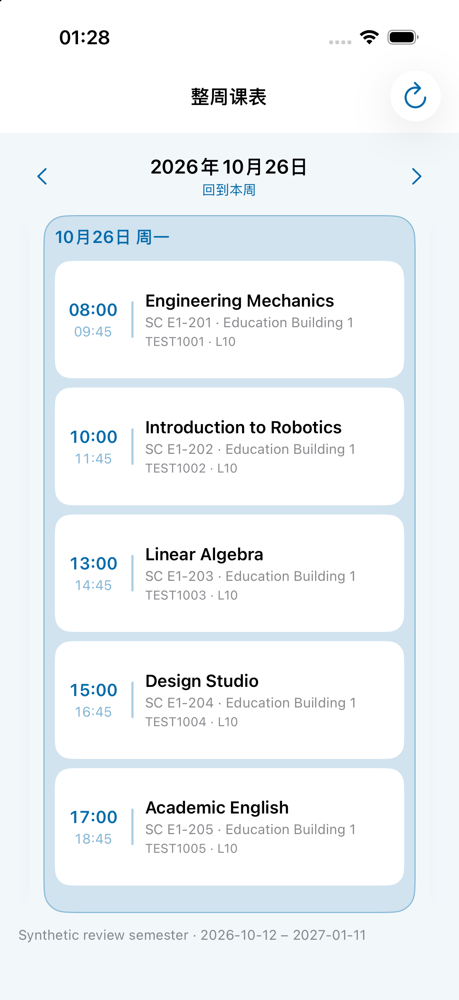

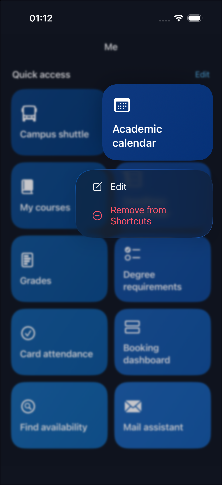

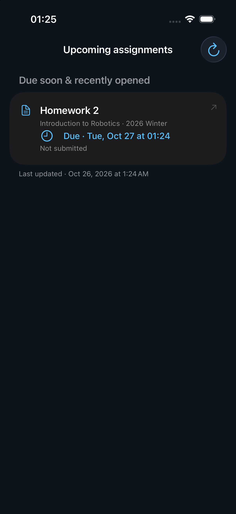

## Build 59 · 图标尺寸修正

- 以有效透明度边界裁定标志范围，去除近透明边缘噪点；保持纵横比，标志高度统一为 800/1024，上下各留 112px。
- Icon Composer、浅色/深色兼容图标及关于页同步使用同一居中版本；保留原始素材和可重复执行的 Swift 资源编译脚本。
- 真机 Release 与模拟器 Debug 构建通过，工程、双语、签名及扩展版本检查通过。独立模拟器桌面核对新图标完整且居中；本轮深色背景检查为资源预览，未做桌面深色切换。
- iPhone 覆盖安装确认 2.0.1 (59)，远程启动成功，未卸载或清除登录/下载。
- 本次仅调整资源及版本，沿用 build 58 的 334 项业务回归结果，未重复运行业务测试。

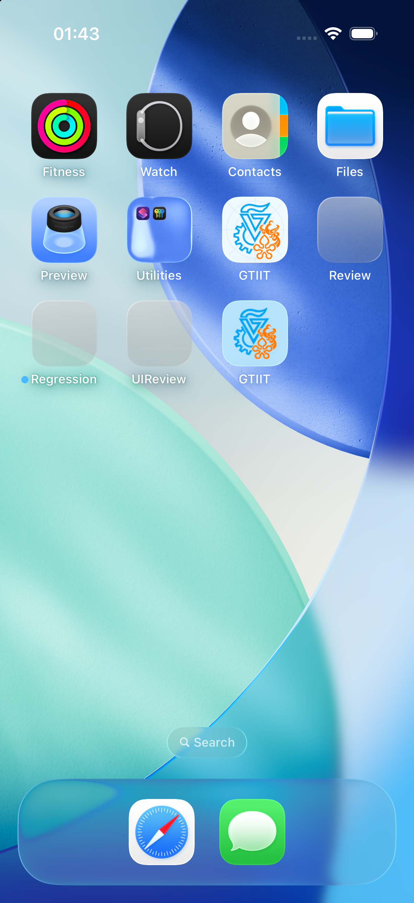

## Build 60 · 原生标题栏、背景与课表反馈

- 原生标题栏在顶端显示页面本色，滚动由系统处理 scroll-edge/材质过渡。iOS 26 不再设置不透明外观；较早系统使用默认材质和透明 scroll-edge。实现依据 [Apple UINavigationBar 外观说明](https://developer.apple.com/documentation/technotes/tn3106-customizing-uinavigationbar-appearance)。
- 统一 nativeNavigationSurface 的背景与列表画布，覆盖以龙、语言、帮助、班车提醒等原先遗漏的页面；“我的”根页面也采用同一策略。
- Student 的 Dark Reader 最终画布覆盖补充 main、根节点内层及页面容器；提高画布选择器优先级，避免网站后加载背景覆盖或颜色被再次转换。
- 整周课表在松手目标确定时更新选中态和触感，去除收尾的隐式淡变，并仅高亮选中日期。时间列从 47pt 扩为 55pt，无障碍字号扩为 96pt，约束单行且允许适度缩放；灵动岛发车时间也约束单行。

验证：338/338 回归通过，新增 Student 嵌套画布、后加载样式、深浅切换检查；最终 UIReview 与真机 Release 编译通过，工程、双语、扩展版本和签名检查通过。独立 iPhone 17 模拟器检查浅色设置顶端、深色设置/以龙背景、英文五节课首屏和单行时间，并通过按钮验证周切换选中态。最后两处纯布局调整（“我的”根标题栏及时间列缩放）经过最终编译/界面复核，未重复业务回归。

验证范围：Student 使用可控的 WebKit 页面夹具，未登录真实门户复核。设备预览的坐标滚动/拖动操作返回 noWindowsAvailable，因此连续手势过程中标题栏渐变及松手触感未完成自动化录屏核对；没有把静态截图当作连续动画证据。

iPhone 已覆盖安装并确认 **2.0.1 (60)**，远程启动成功，未卸载或清理用户数据。

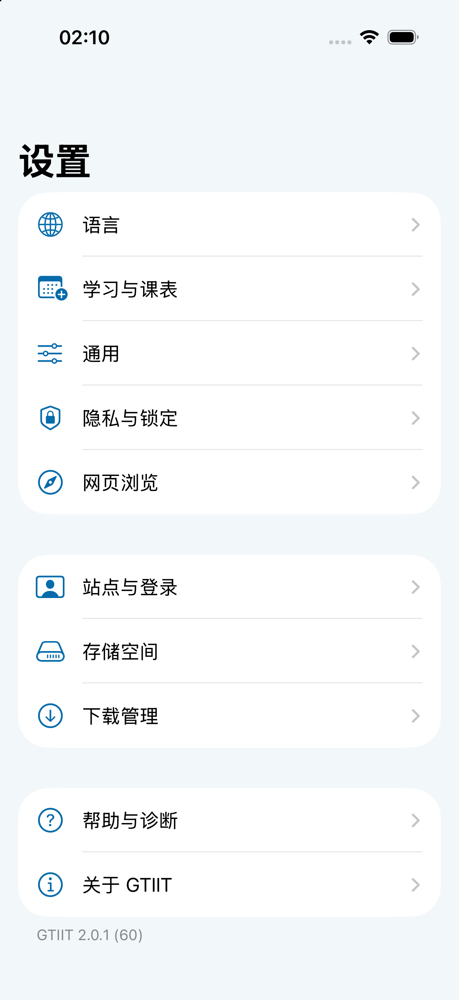
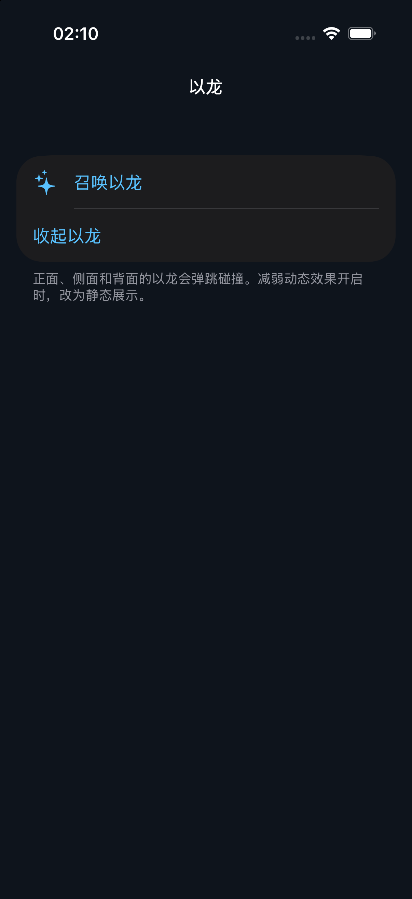
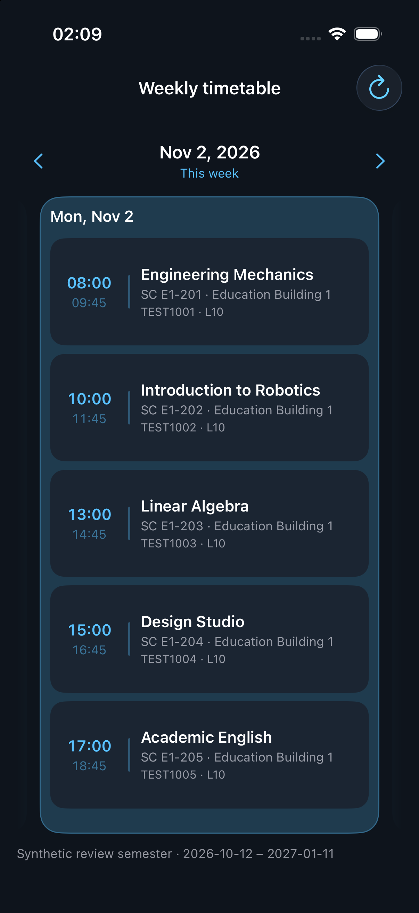

## Build 61 · 门户横屏与跨周阻力

- 门户首页及门户原生详情路由根据实际可用视口隐藏横屏导航栏，旋转回竖屏自动恢复。仅改变导航栏显示，不重建 WebKit、不刷新页面。
- 周日→周一及周一→周日的跨周拖动初段仅移动手指距离的 50%，跨周需达到卡片步长的 60%（原为 38%）。松手仍只切换相邻一天。
- 拖动距离直接来自 pan gesture 的真实位移，避免把已施加阻力的 contentOffset 再累计导致距离放大；移除重复短甩绕过边界的逻辑。
- 新增横/竖屏策略、其他站点不受影响、阻力距离以及双向中等距离拖动不跨周的检查。

界面验证：在独立 iPhone 17 模拟器使用不含账号信息的门户夹具，实际旋转检查横屏隐藏、竖屏恢复；网页保留同一内容。真实手指的跨周阻力体感尚未自动化验证。

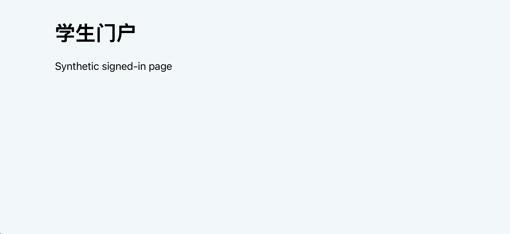
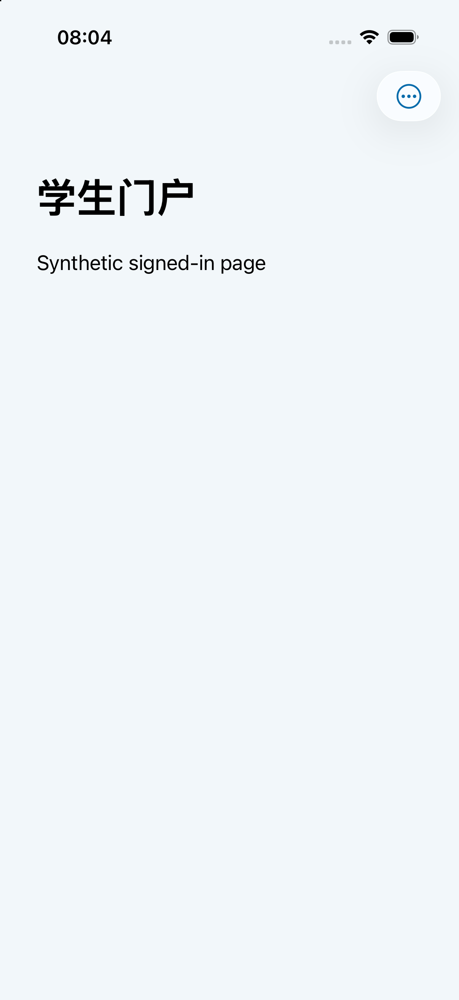

验证结果：最终源码 344/344 回归通过；UIReview、真机 Release、工程、双语、扩展版本及签名检查通过。iPhone 覆盖安装确认 **2.0.1 (61)**，远程启动成功，原登录和下载数据未清除。

## Build 64 · 一级回顶、并发刷新与自适应导航

- 一级原生页面重复点击当前标签时使用班车相同的 0.3 秒 ease-in-out 回顶，尊重“减弱动态效果”。不再重建一级导航栈；处于二级路由时仍回到首页。
- 门户及旧网页首页重复点击时保留文档并滚动到顶，同时处理 Student 的 main 内层滚动；不在官网首页时仍返回官网首页。
- 大屏（可用宽度≥700pt）或手机横屏（宽度≥600pt 且宽>高）启用原生 UISplitViewController 与系统 List(.sidebar)。系统管理材质、选中效果和侧栏控件，保留同一 TabView 和子页面身份；宽布局使用公开的 regular size-class trait override，窄布局回到底部标签栏。iPadOS 根据窗口可用宽度自适应，而不依赖设备方向或固定屏幕尺寸。
- “回到本周”改为“回到今天 / Today”，继续定位当日卡片。
- 日历 RPC 与课程目录并行；课程和作业详情采用6个工作槽，所有请求共享6个并发上限。保留超时、取消、学期筛选、30分钟刷新周期和单一刷新任务；课程目录先发布，作业检查结束后一次更新正式摘要缓存。
- 课程预览按任务 token 校验，旧任务不能覆盖新结果；并行到达的日历事件不会覆盖本轮作业详情的权威截止时间。

并发验证使用 WebKit 合成课程数据，不代表校园服务器实际延迟：12门课程检查完整，请求峰值6，课程目录在作业详情读取前发布，任务结束后进度与请求清空。四站预加载策略未改变。

- 分栏外层、内容宿主与安全区统一使用 Theme.pageUIColor，浅色 #f2f7fa、深色 #0e141c；系统玻璃侧栏保留自身材质。

- iPhone 横屏仅在侧栏左侧安全区使用与菜单材质底色相匹配的背景，iPad 不修改该区域；侧栏右上角提供收起操作，收起后可重新展开。

验证：351项完整业务回归通过，随后对分栏与安全区修改补跑37项布局回归，全部通过；最终侧栏收起/展开和 iPhone 专用底色使用独立 UIReview 检查。工程结构、中文/英文覆盖、Release 设备构建、App/Widget 版本和签名检查通过。

界面检查使用 iPad Pro 13-inch（iPadOS 26.5）和 iPhone 17（iOS 26.5）独立模拟器：检查深浅色画布、横竖屏原生侧栏、设置二级导航，以及 iPhone 设置页旋转后保留当前页面并正确显示返回按钮。收起后左下角提供系统玻璃展开按钮，避开详情页的顶部操作。

最终包已覆盖安装 iPhone Air，设备确认 **2.0.1 (64)**，远程启动成功；未卸载或清理现有登录和下载。

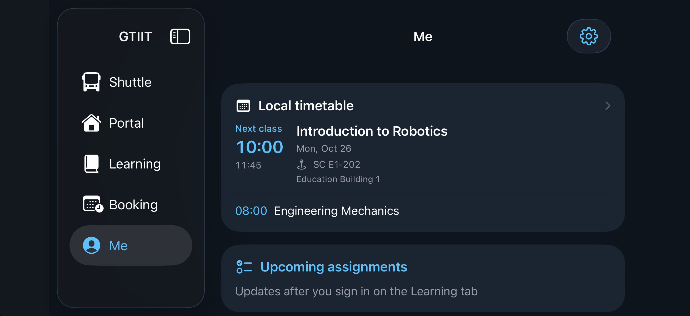
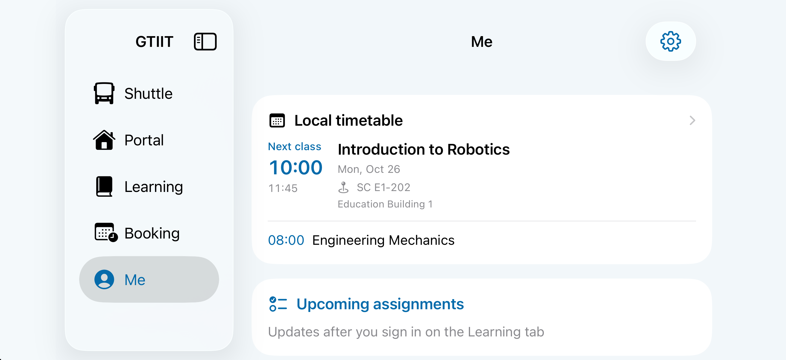
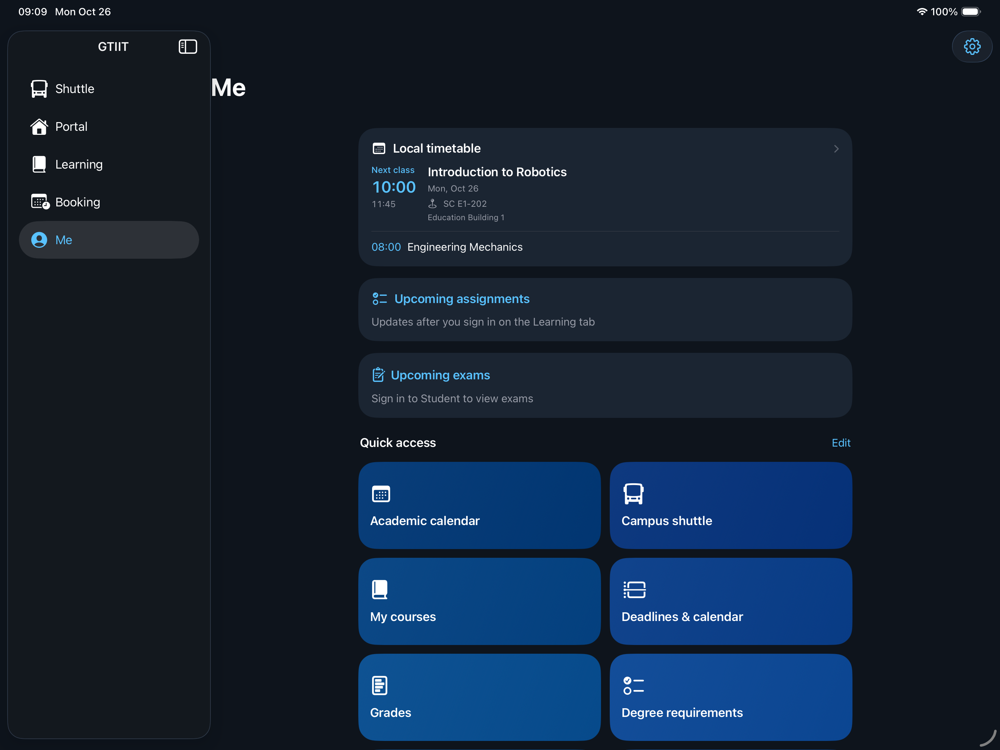
