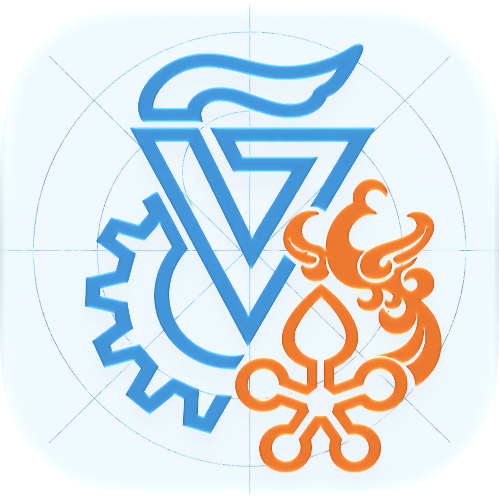
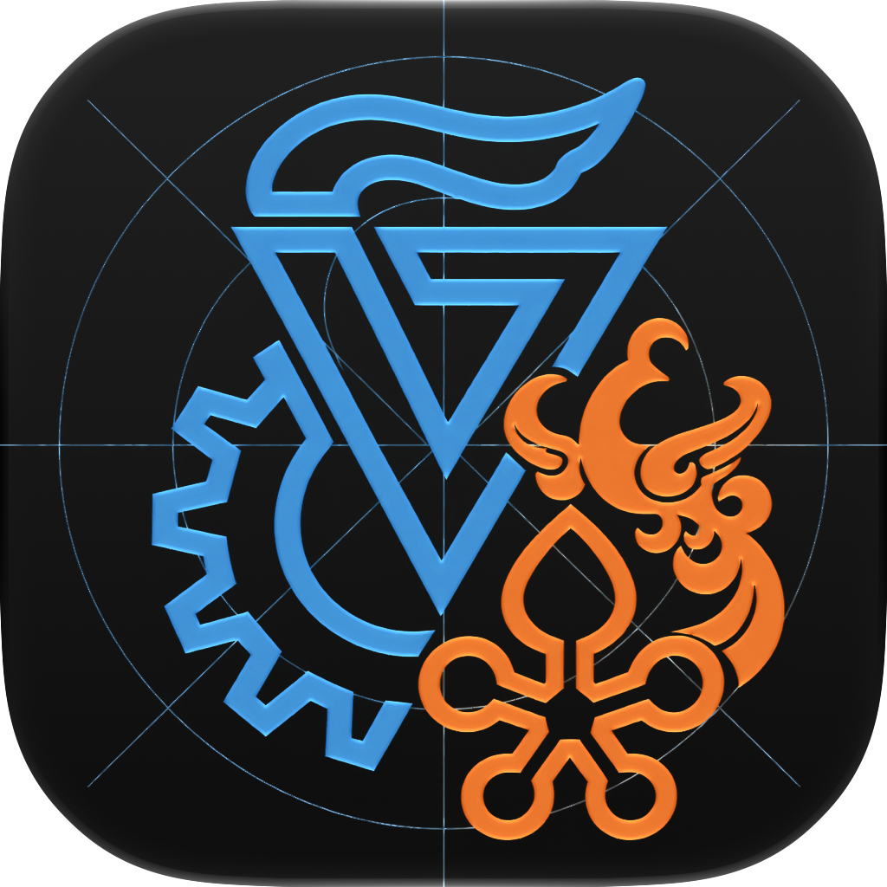
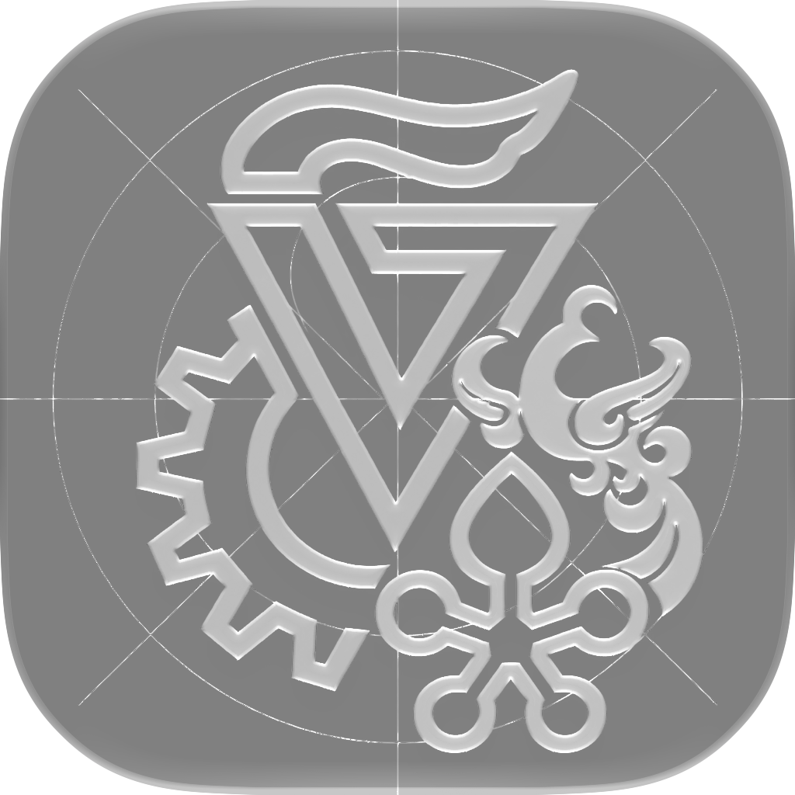

# GTIIT 1.2 · Campus in motion

## 参考看板

| 参考来源 | 采用的设计原则 | 本项目应用 |
| --- | --- | --- |
| [ArtCenter College of Design](https://www.artcenter.edu/) | 清楚的内容分区、简短标题、突出核心信息 | 班车页首先呈现两方向的下一班，大字号倒计时 |
| [RISD Graphic Design](https://www.risd.edu/academics/graphic-design) | 编辑式字体层级、网格、内容优先 | 左右平行线路、等宽时间、低密度信息 |
| [Apple Icon Composer](https://developer.apple.com/icon-composer/) | 透明前景和背景分层、系统材质、适配图标外观 | 可编辑的 Icon Composer 工程保存在 `docs/design/AppIcon.icon`（Xcode 27 下可编译 Liquid Glass；主工程默认使用 PNG 图标，以便 Xcode 26 构建） |
| [Apple HIG](https://developer.apple.com/design/human-interface-guidelines/) | 系统导航、44pt 触控、语义字体、动态字号、辅助功能 | 原生 Tab / List / Menu / Quick Look / Files，遵循减弱动态效果 |

参考的是排版和信息层级，天蓝／橙色是本项目的独立配色，不声称上述学校使用同一配色。

## 色彩与材质

| 色彩 | 浅色 / 深色 | 用途 |
| --- | --- | --- |
| 天蓝 | #056BAB / #59C2FF | 操作、南→北、主强调；深色提高亮度 |
| 暖橙 | #B54A0F / #FFA85C | 北→南、教学周车次、校门提示 |
| 纸面 | #F2F7FA / #0E141C | 原生页面背景 |
| 表面 | 系统分组背景 | 信息卡、列表，自动跟随系统 |

浅天蓝只用于下载浮窗和图标的底色，文字使用更深的天蓝以保持可读性。
44pt 菜单按钮；22pt 班车卡圆角；20pt 页面边距；SF 系统字体，时间等宽。

## 图标看板

基于用户提供的校徽进行非官方改绘：保留火炬、几何 V、齿轮、花朵；移除印章式外圈和环绕文字，加入轻量制图辅助线。完整方形背景由 Icon Composer 提供，系统负责外部蒙版，没有额外套一层边框或预留一圈空白。分层工程不在编译目标内，见 `docs/design/AppIcon.icon`。

图像素材使用内置 image_gen 生成，透明 PNG 缩放到 1024px 后导入；玻璃、光照和阴影来自 Apple 原生渲染，并非贴在 PNG 里的假玻璃。原始两次提示词见 `image-prompt.txt`。

## 动效

倒计时使用原生 numericText，只有值变化时短过渡。班车内容初次进入淡入并上移 10pt / 350ms；下载面板约 300ms 滑入。系统“减弱动态效果”开启时取消位移与数字滚动。参考 transitions-dev 的数字变化、浮层出现原则，原生 SwiftUI 实现，无循环装饰动画。

## 数据与交互边界

- 班车以用户给出的 2026-10-12 表为唯一来源，共 58 个独立车次；1 号每日，2 号仅教学周指定星期。教学周由用户手动确认；假期、调休及校方临时通知不推断。
- 倒计时为北京时间计划发车，不具备实时 GPS 或预计到站数据；过末班自动显示次日。
- 顶栏仅显示可点击回主页的页面标题与“更多”；前进、后退、刷新保留在更多菜单，网页边缘后退手势保留。
- PDF 当前响应直接进入 WKDownload，不额外重放 GET。完成后可 Quick Look 预览，或经系统文件选择器另存到 iCloud Drive 等位置。
- 下载完成面板 4 秒后以 250ms 渐隐；切标签、预约分类或继续浏览网页时立即收起。面板生命周期与文件保留独立。
- 文件默认永久保存在 App Documents/Downloads，暴露给“文件”；限时保留为显式可选设置。

下载反馈只使用一个面板：主页面和子窗口互斥呈现，不再叠加下载完成 Toast。iOS 26+ 用原生 glassEffect 与 interactive 材质；App 身份卡片位于设置的关于页。

## 班车页验收

