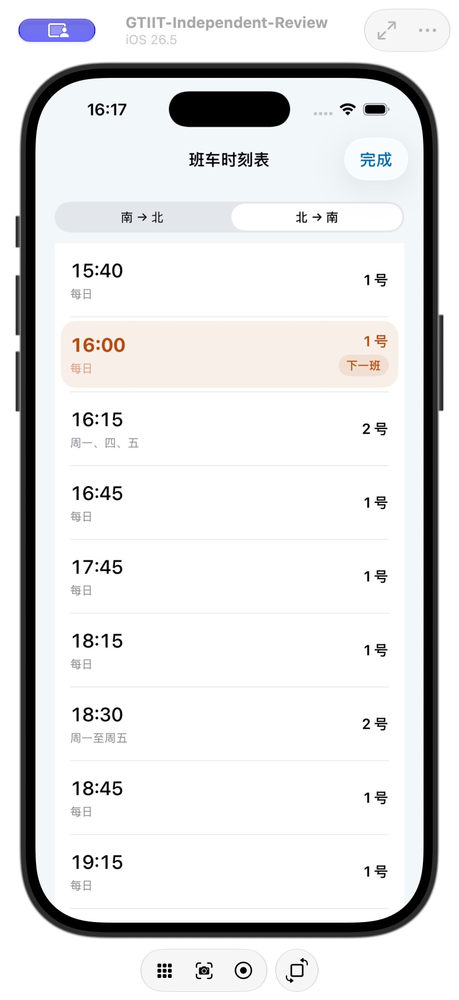
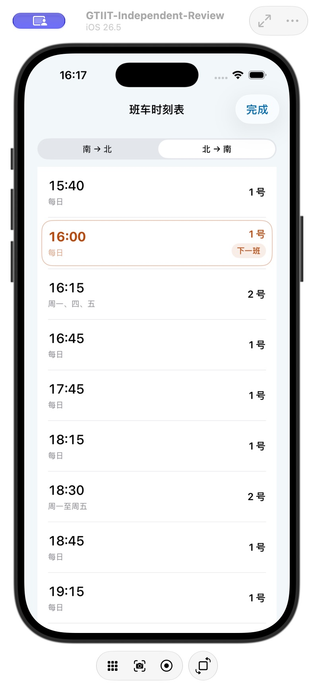
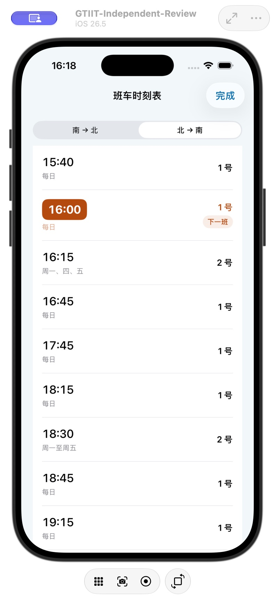

# 班车高亮外观审核 · 2.0.4 beta.3 候选

三个方案使用同一生产 SwiftUI 行组件，仅切换 `ShuttleHighlightStyle`。时间固定为北京时间 2026-10-27 15:42，北 → 南；上一班 15:40，下一班 16:00。默认滚动让上一班在首行，下一班在第二行，保留用户提供的视觉位置。

- A / tonal：轻柔色底，右侧小型“下一班”标签；当天不再追加“今天”。
- B / outline：细描边，无整块填色，右侧下一班标签。
- C / timeBadge：仅时间为强调色块，整体保持白底。

蓝色用于南 → 北，橙色用于北 → 南。三种均使用系统字体、动态颜色、VoiceOver 合并朗读及选中语义。用户已选定 A「柔和底色」，作为发布默认方案并覆盖安装。

截图采用独立测试包，不包含用户真实工单或作业。

| A · 已选定 | B | C |
|---|---|---|
|  |  |  |

[暗色检查](A-tonal-dark.png) · [提醒选项](reminder-options.png) · [服务中心测试数据](service-center-synthetic.png)
