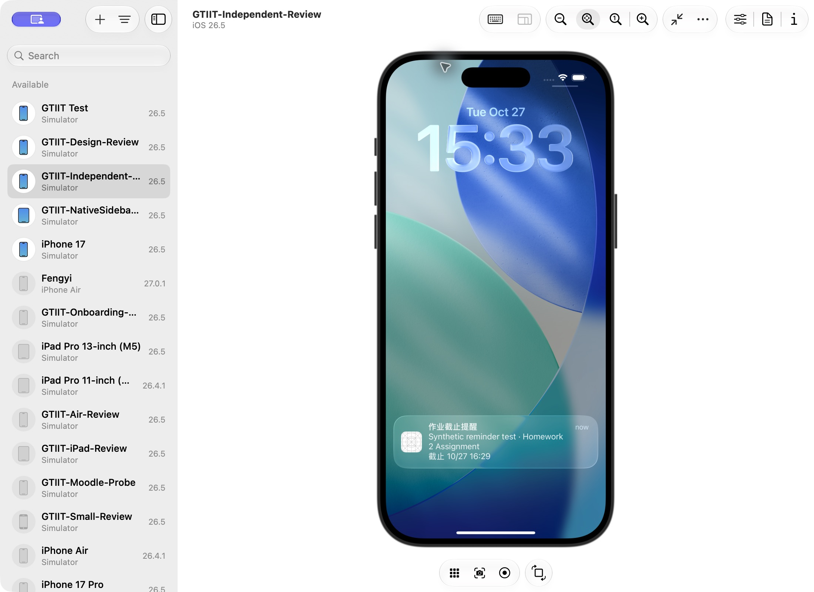
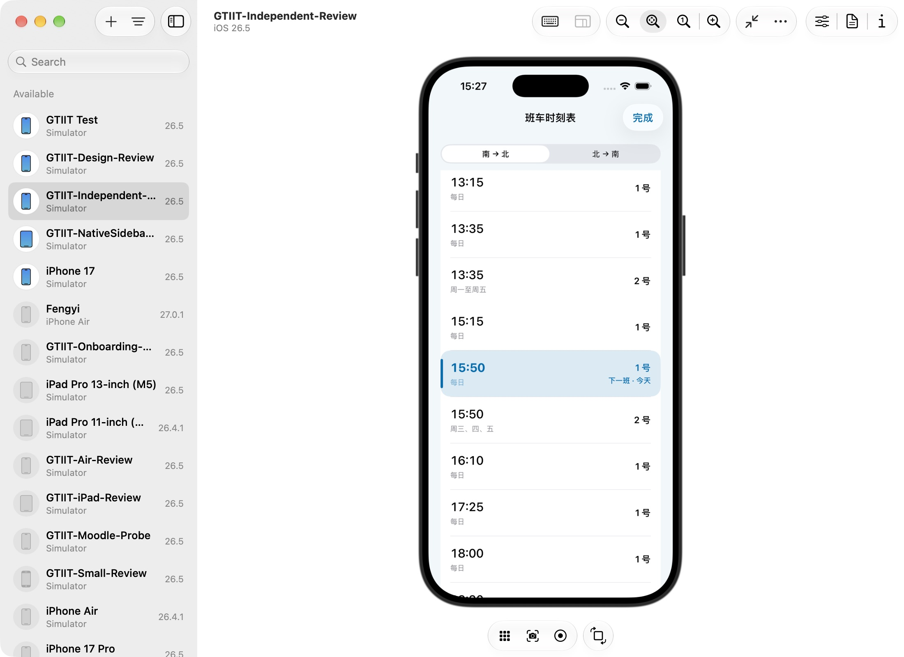
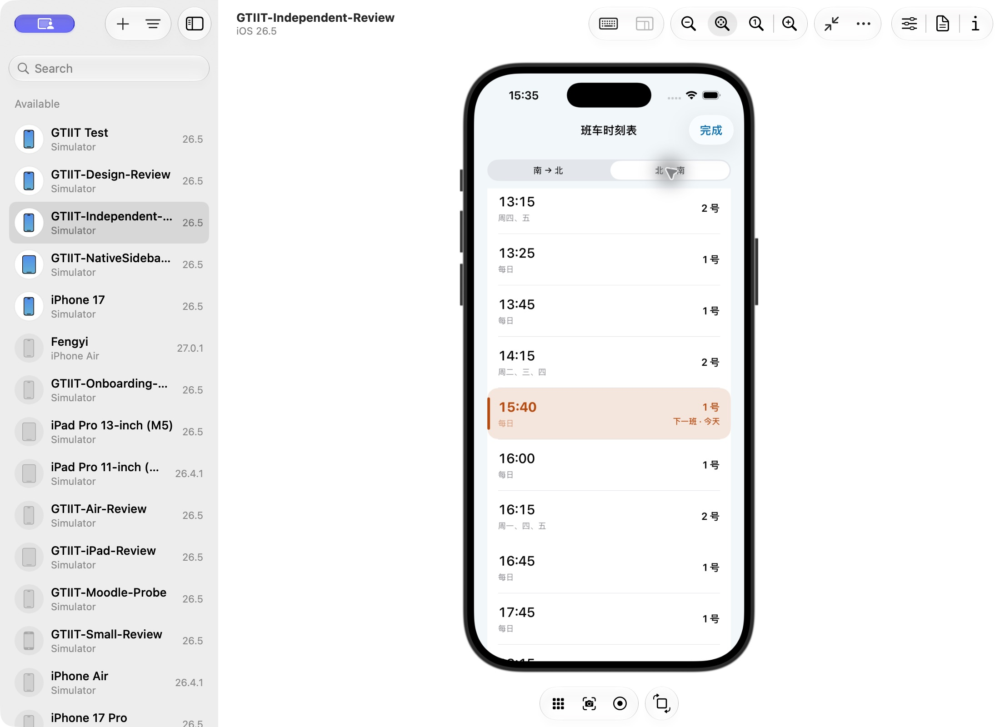

# 截止提醒与下一班 · 2026-10-27

- 版本：2.0.4-beta.2（75）。
- 完整回归：regression-results.json，433 / 433。
- 其中新增通知检查：25 项，实际通知 API 的替身测试覆盖排程与持久去重；系统 UI 另用独立 UIReview 验证授权和实际送达。
- source-sha256.json：最终源码哈希。完整回归后另补一处解锁同步调用，最终签名 Release 再构建通过。
- 所有截图仅包含模拟器和虚构课程，不含真实学生作业记录。

## 实际系统通知

## 班车两个方向

