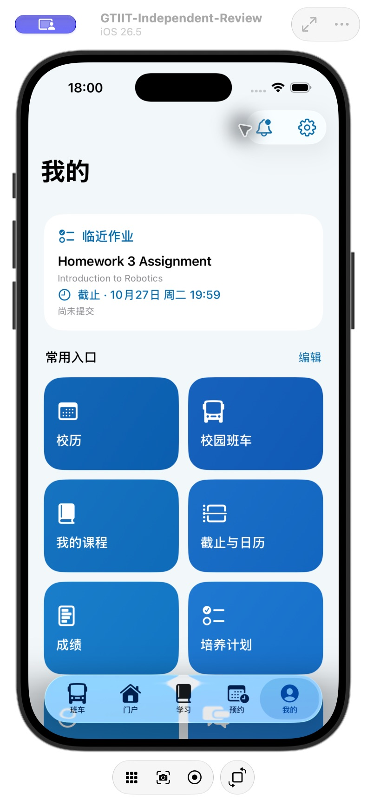
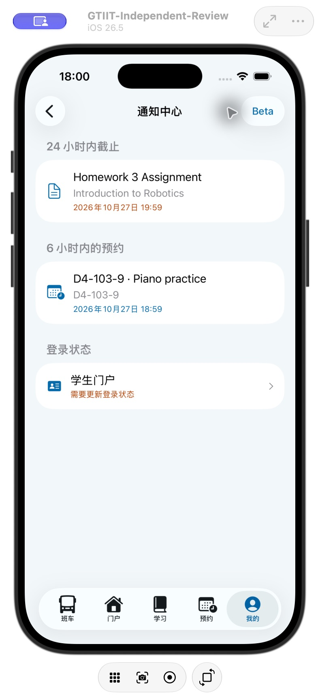
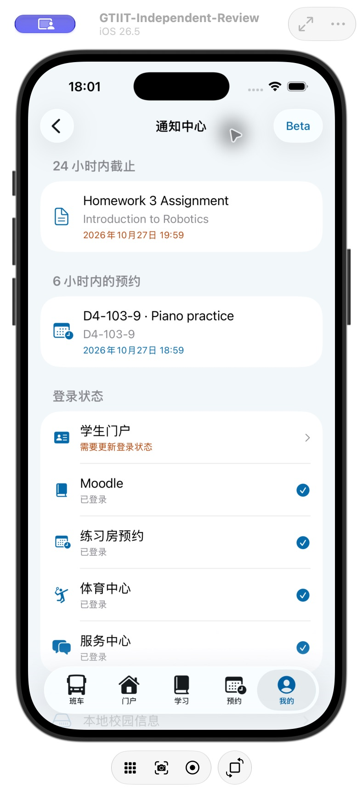

# 通知中心精简与工具栏 · build 78

- 使用独立模拟器与虚构课程、预约、登录状态。
- 已验证：共享玻璃工具栏收紧；普通模式只保留实际消息；打开 Beta 后展开所有站点检测项目。
- 专项回归 19 项通过。完整 478 项回归保留于 beta.4 记录，本次没有重复全量测试。
- iPhone Air 已覆盖安装，设备清单确认 2.0.4 (78)。首次远程启动超时，重试启动成功；未卸载或重置数据。

