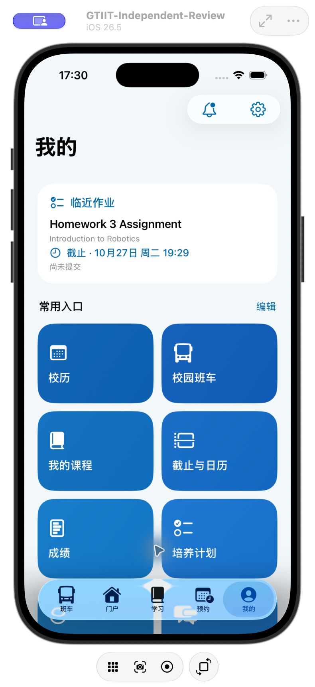
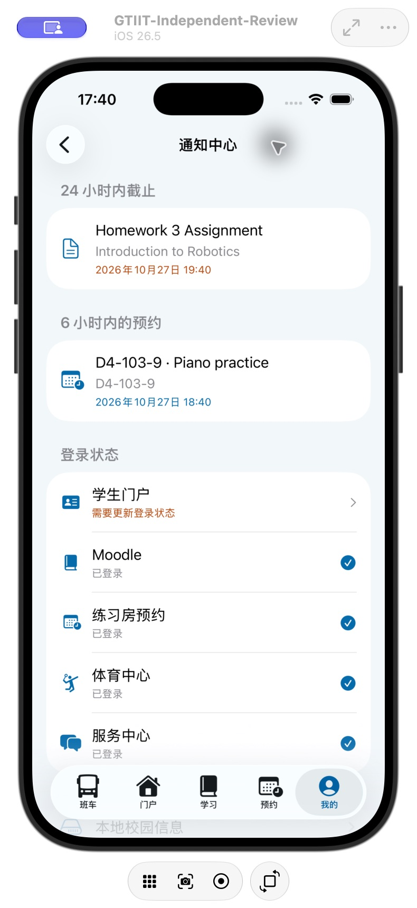
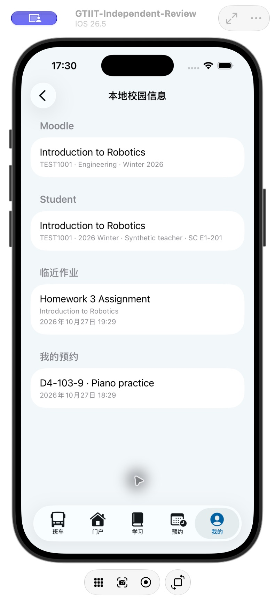
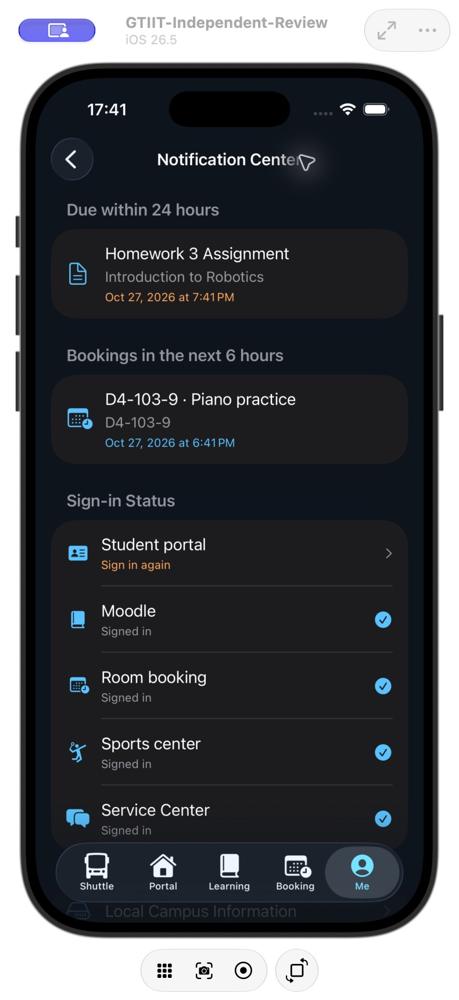
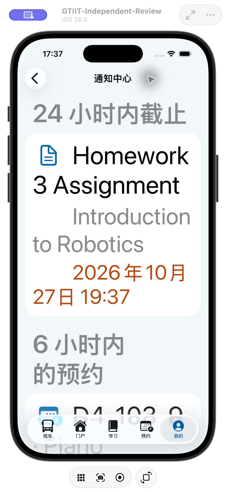

# 通知中心与本地缓存验证 · build 77

- 完整回归：478 项通过。
- 随后补充课程异步加载等待与预约响应源验证，定向 inbox 回归 16 项通过，包含延迟课程结果、24 小时／6 小时时间边界、去重、取消、缓存持久化、跨学期、旧 7 天期限、登录正负判断与公共日历拒绝。
- 前两轮复跑出现门户脚本初始化顺序问题；DOMContentLoaded 再合并 showcase 新手偏好，保留其他键值，复跑通过。独立 WebKit 进程冷启动的 fixture 标题等待改为 15 秒，后续业务条件不变。
- 原生界面实测：共享玻璃按钮、三类消息、缓存列表、预约消息路由、英文暗色模式、最大辅助字号。测试课程、预约和登录状态为虚构内容，不作为本人真实待办证据。
- 项目一致性、中英文文案、Release 与 App／Widget 版本和签名检查通过。实际站点预约未自动创建、修改或取消。

- iPhone Air 覆盖安装成功，设备确认 2.0.4 (77)，远程启动成功。最后日期标签排版在最大字号下无省略，签名 Release 已验证。

