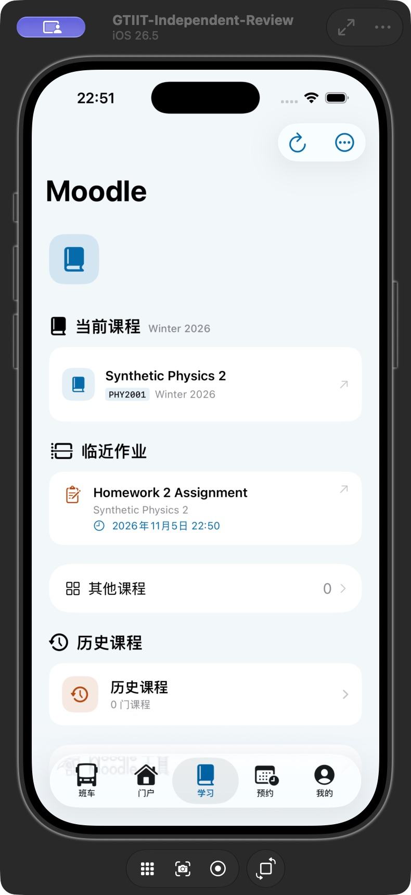
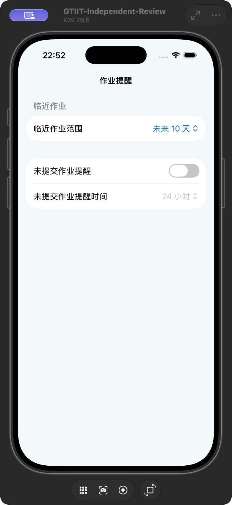
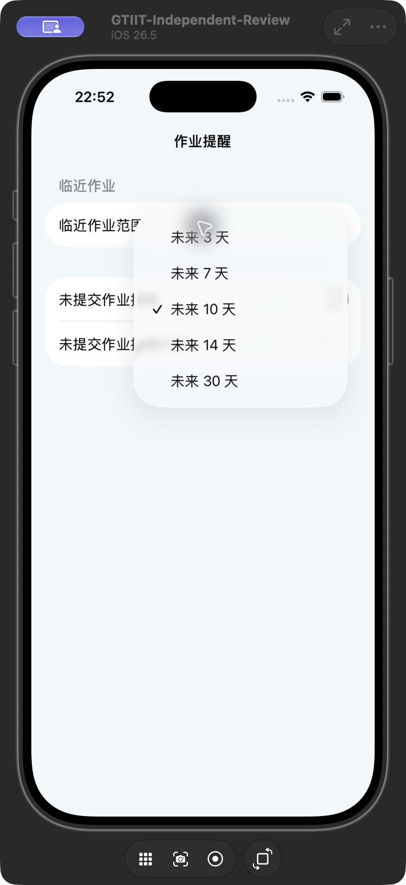
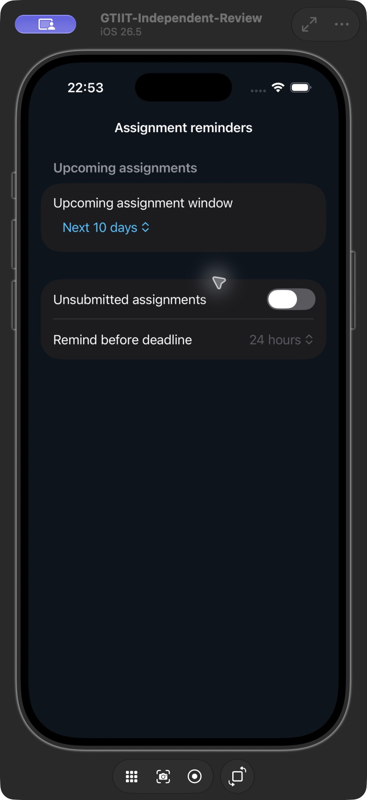

# Moodle 完成状态与缓存优先 · build 79

- 完整回归 508 项通过；随后相对目录链接专项回归 60 项通过。
- 使用真实物理二页面的 Finished／Submitted 状态结构，回归和界面截图采用虚构课程与成绩占位，不上传真实账户或成绩页面。
- 冷启动验证：先注入一次测试缓存，再结束进程，无注入重新启动并禁用摘要刷新。课程目录与 Homework 2 文本直接显示；缓存中的已完成 HW 01 和范围外 HW 03 不显示。
- 设置中默认未来 10 天，可选 3／7／10／14／30 天，英文暗色布局已核对。
- iPhone Air 设备清单确认 2.0.4 (79)。第一次包启动成功，并核对实际摘要：16 门活跃课程完整检查，指定物理二 HW 01 状态为 submitted。
- 最终相对目录补全包覆盖安装成功；此时手机锁定，系统拒绝远程启动，因此尚未核对该包在手机上补齐的新目录内容。60 项专项验证已覆盖相对链接解析及不在日历中的 Quiz 读取。
- Release、App／Widget 版本与签名、工程结构、中英文文案检查通过。未卸载或重置登录／下载数据。

