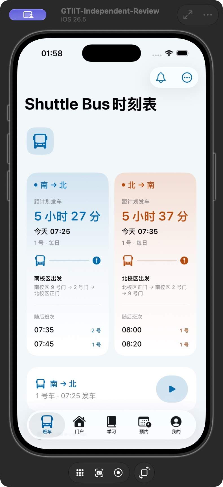
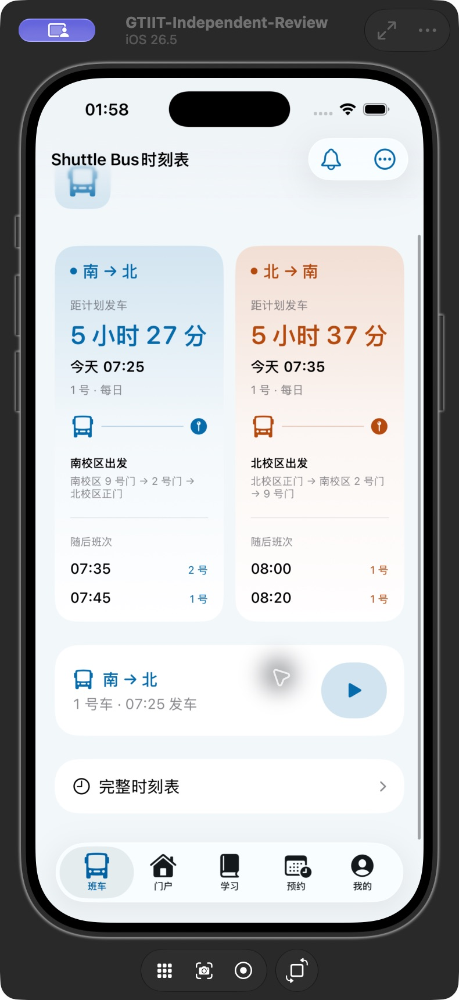
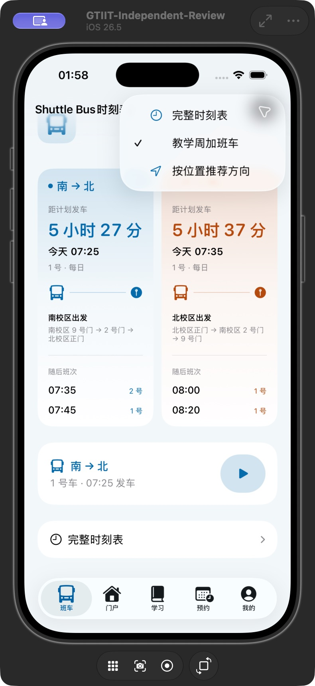
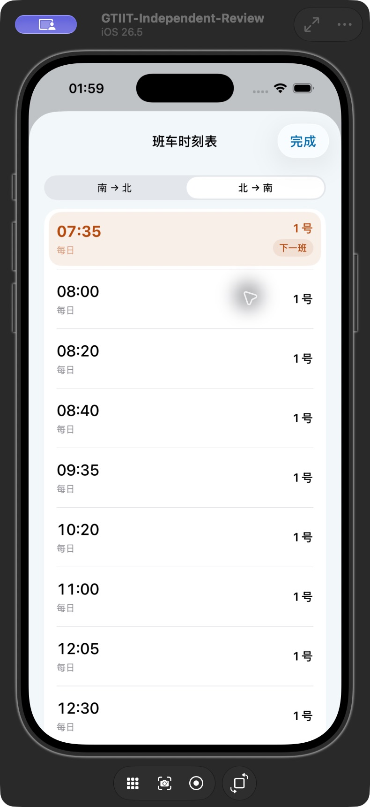
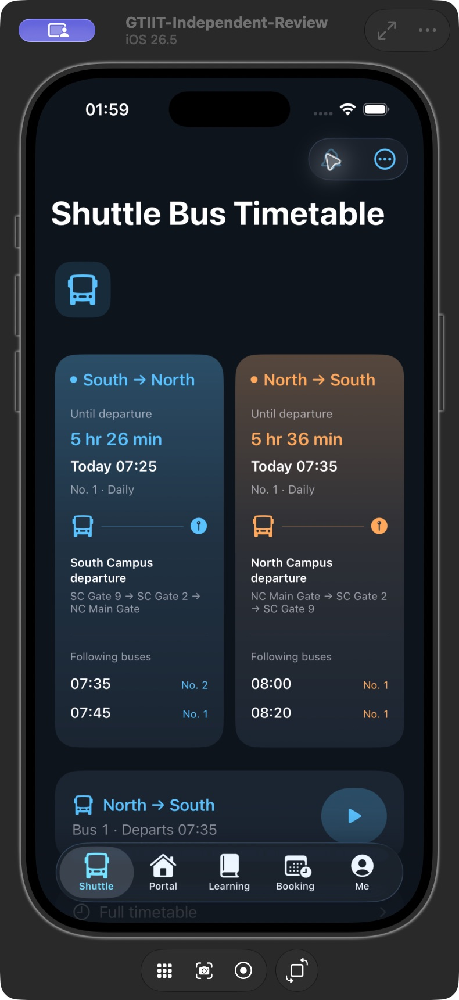

# 班车页原生统一 · build 80

- 浅色首屏与英文暗色标题正常显示；滚动后使用系统小标题。
- 教学周开关关闭后，南到北后续班次从含 2 号车的 07:35 改为每日 1 号车 07:45／08:10；恢复开启后班次还原。
- 点击北到南卡片，详情显示北到南分段；提醒按钮打开原生提醒表单，未创建通知或申请定位权限。
- 班车系统检查 25 项通过。工程一致性、本地化及签名 Release 检查通过。
- iPhone Air 已覆盖安装，设备清单确认 2.0.4 (80)，devicectl 远程启动成功；未卸载或重置登录／下载数据。

