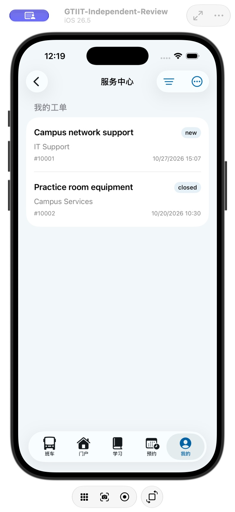
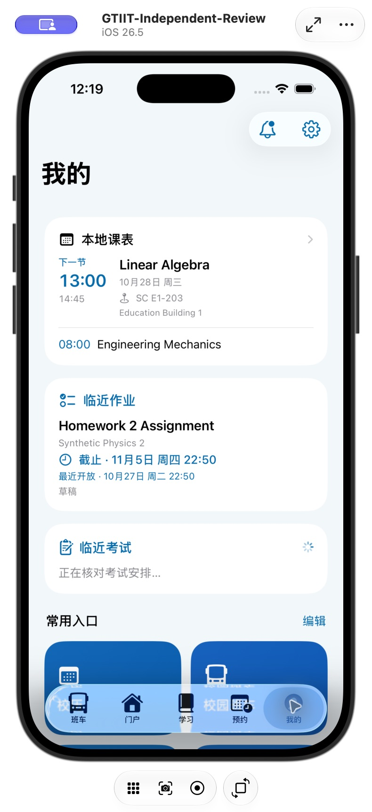
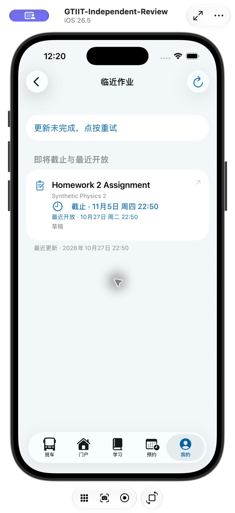
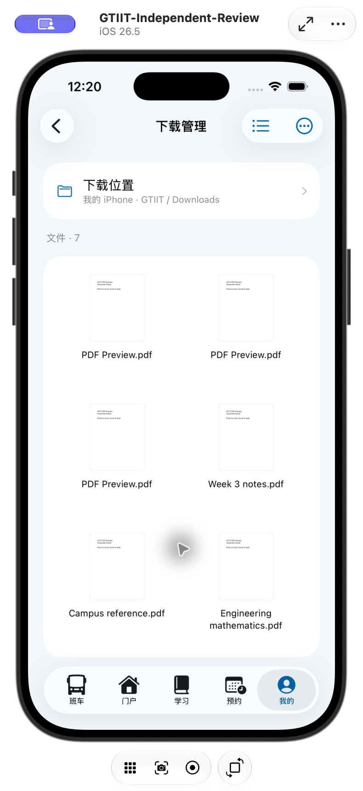
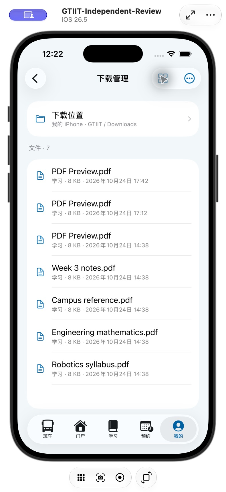
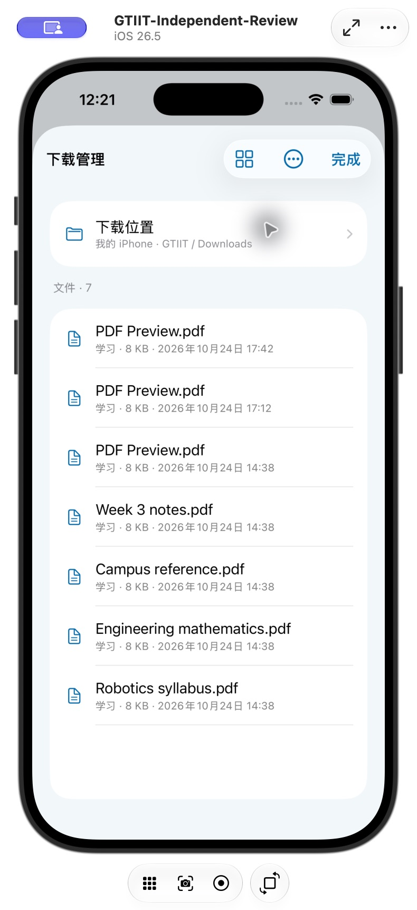
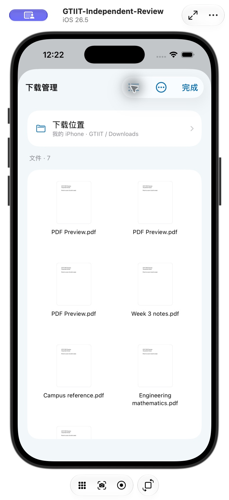
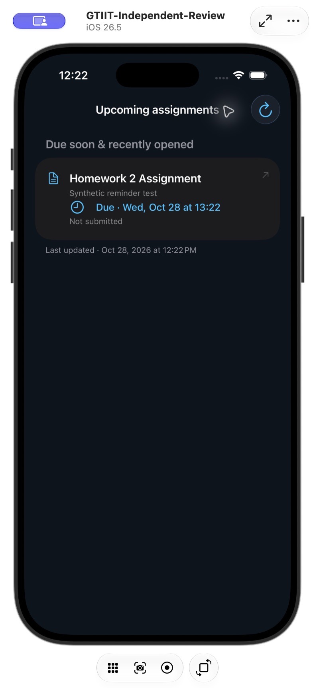

# 结构整理验证 · build 81

- 完整回归 514 项通过，包含旧缓存兼容、持久化与清理、缓存保护、损坏／尺寸拒绝、失败写入不覆盖、作业稳定排序及既有网页／下载流程。
- Release 构建、App／Widget 签名版本、工程一致性和本地化检查通过。
- 独立模拟器中的课程、工单、文件均为测试内容。
- 服务中心详情下重选“我的”回到根页，旧路由没有再次打开；从摘要打开共用作业详情，返回原入口。
- 下载从“我的”进入使用返回按钮，从门户更多菜单进入则使用独立弹窗的完成按钮；关闭后回到门户，未额外嵌套导航栈。
- 已核对列表／网格切换完成后的顶部下载位置、文件计数与表面布局；英文暗色详情正常。
- iPhone Air 覆盖安装成功，设备清单确认 2.0.4 (81)，远程启动成功；未卸载或重置登录及下载数据。

